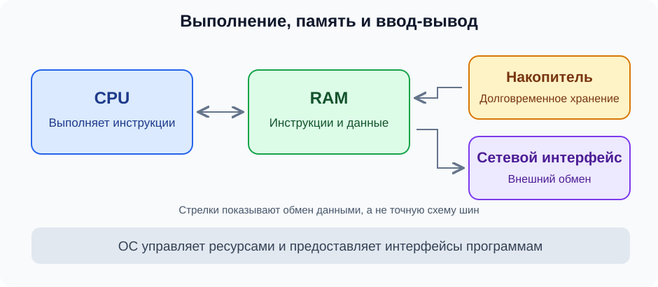

# Компьютер: что происходит при работе программы

Компьютер выполняет инструкции над данными. Чтобы понять работу программы, сначала различим выполнение, хранение и обмен данными; затем — ресурсы, которые ОС предоставляет запущенной программе.

## Основные части

На схеме показаны роли компонентов и обмен данными, а не точная схема шин. Кэши, контроллеры и способы передачи данных разберём отдельно.

| Компонент | Роль | Пример для backend |
|---|---|---|
| CPU — процессор | Выполняет машинные инструкции | Вычисляет значение по данным запроса |
| RAM — оперативная память | Хранит используемые инструкции и данные | Содержит рабочие данные процесса |
| Накопитель | Хранит файлы между запусками | Содержит исполняемый файл и файлы базы |
| Сетевой интерфейс | Передаёт и принимает данные через сеть | Получает запросы и передаёт ответы |

Оперативная память и накопитель нужны для разных задач. Сохранение значения в памяти процесса само по себе не означает сохранение в файле.

## Программа и процесс

Исполняемый файл — ещё не работающая программа. При запуске ОС создаёт процесс, подготавливает его адресное пространство и необходимые ресурсы, организует исполнение. Один файл можно запустить несколько раз и получить несколько процессов.

Адресное пространство — представление памяти, доступное процессу. Его адреса не следует считать прямыми номерами ячеек физической RAM. Как ОС и оборудование связывают эти представления, разберём в виртуальной памяти. Загружать весь файл в RAM заранее для старта не обязательно: детали загрузки относятся к отдельной теме.

CPU выполняет машинные инструкции. Для первой модели достаточно операций «прочитать», «вычислить», «записать», «перейти к другой инструкции». Современный процессор устроен сложнее этой последовательной картинки. Сопоставлять каждую строку Go одной инструкции нельзя.

## Где здесь операционная система

ОС управляет ресурсами и предоставляет программам интерфейсы для работы с ними. Процесс использует CPU и память, а для действий вроде работы с файлами обращается к ядру через системные вызовы. Не каждая операция программы требует такого обращения.

Сначала отделим аппаратные ресурсы от программных абстракций. CPU и RAM — оборудование. Процесс, его адресное пространство и файловый дескриптор — понятия, через которые ОС организует работу программы с ресурсами.

## Учебная ситуация

Сервис получает число, прибавляет единицу и возвращает результат. Рассмотрим только роли, без деталей протокола и реализации Go:

1. Входные данные приходят через сетевой интерфейс и обрабатываются сетевым стеком ОС.
2. Код сервиса получает данные в доступной ему памяти и выполняет вычисление на CPU.
3. Результат передаётся для отправки через сеть.

Это не означает, что запрос обязательно записывается на накопитель. Работа с базой или файлом — дополнительные действия. Позже проследим весь путь запроса и уточним буферы, копирование и системные вызовы.

Пока программа ожидает внешний ввод-вывод, её работа не обязана занимать CPU непрерывно. Поэтому сначала полезно спрашивать: «Она вычисляет или ждёт?»

## Границы этой модели

Здесь ещё нет устройства кэшей, аппаратных и программных потоков, виртуальной памяти и планировщика Go. Эти понятия появятся после их предпосылок. Электрическая схема процессора для следующего шага не требуется.

## Обсудим вместе

- Чем исполняемый файл отличается от процесса?
- Почему свободный CPU ещё не доказывает, что программа работает быстро?
- Что на схеме относится к оборудованию, а что добавляет ОС?

Ответы и личные формулировки автора пока не записаны. Эта статья — предложение для разбора, тема не отмечена пройденной.

## Источники и проверка

Проверены 27 октября 2026 года. Текст и схема написаны для этой базы, примеры описательные; команды и эксперименты не запускались.

- [OSTEP, Introduction to Operating Systems](https://pages.cs.wisc.edu/~remzi/OSTEP/intro.pdf) — выполнение инструкций, ресурсы, роль ОС и интерфейсы к ней.
- [OSTEP, The Abstraction: The Process](https://pages.cs.wisc.edu/~remzi/OSTEP/cpu-intro.pdf) — программа на диске, запуск, ресурсы и состояние процесса.
- [OSTEP, The Abstraction: Address Spaces](https://pages.cs.wisc.edu/~remzi/OSTEP/vm-intro.pdf) — представление памяти процесса и отличие от физического размещения.

Дальше: биты, байты и представление данных — [очередь](../../navigation/progress.md). Вернуться к [карте области](README.md).
