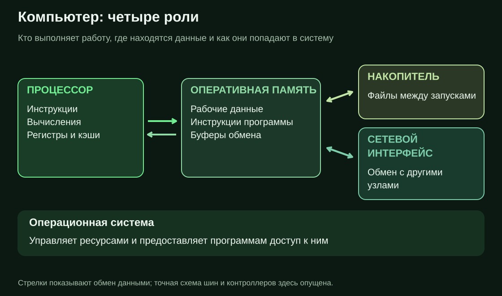

# Компьютер

Компьютер — устройство, которое хранит данные, выполняет над ними заданные операции и обменивается данными с внешним миром. Последовательность выполняемых инструкций называется программой.

Для понимания работы обычного компьютера достаточно сначала различить четыре роли:

| Часть | Что делает | Пример |
|---|---|---|
| Процессор, CPU | Выполняет инструкции | Складывает числа, сравнивает значения, выбирает следующий шаг |
| Оперативная память, RAM | Хранит используемые инструкции и данные | Содержит обрабатываемый документ и рабочие буферы |
| Накопитель | Хранит данные между запусками | Содержит файлы программы и сохранённые документы |
| Устройства ввода-вывода | Обеспечивают обмен с внешним миром | Сеть, клавиатура, экран, накопитель |

Накопитель тоже является устройством ввода-вывода. Он выделен в таблице из-за роли долговременного хранения.

Стрелки обозначают обмен данными. Контроллеры, кэши и соединения между компонентами здесь опущены; это схема ролей, а не электрическая схема.

## Инструкции и данные

Инструкция задаёт действие: прочитать значение, выполнить вычисление, записать результат, проверить условие или перейти к другому месту программы. Процессор распознаёт инструкции определённого формата — своей **архитектуры набора команд**, например x86-64 или ARM64.

Данные сами по себе не объясняют, как их трактовать. Одни и те же байты могут обозначать число, текст, изображение или инструкции. Смысл определяется форматом и тем, кто их обрабатывает. [Представление данных](02%20Представление%20данных.md) разбирает это на конкретных значениях.

## Что происходит при запуске

В обычной системе с операционной системой исполняемый файл сначала находится на накопителе. При запуске ОС создаёт **процесс** — работающий экземпляр программы с памятью и ресурсами — и подготавливает выполнение его инструкций.

Нужные участки файла становятся доступны в памяти; читать весь файл заранее необязательно. Процессор исполняет подготовленные инструкции. Если программе нужны данные из файла или сети, она использует интерфейсы ОС. Ожидание устройства может приостановить выполнение соответствующей задачи; в это время процессор может заниматься другой.

Пример: обработка изображения требует получить его байты, выполнить вычисления над ними и сохранить результат. Эти этапы нагружают разные ресурсы. Быстрый процессор не устраняет медленное чтение, а быстрый накопитель не сокращает число вычислений.

## Три разных ограничения

**Ёмкость** — сколько данных помещается. **Задержка** — сколько времени занимает одна операция. **Пропускная способность** — сколько работы выполняется за единицу времени.

Большая RAM увеличивает доступный объём, но не делает каждую инструкцию быстрее. Высокая скорость передачи больших файлов не гарантирует малую задержку одиночного чтения. Эти характеристики нужно сравнивать отдельно.

Файл на накопителе и его рабочая копия в памяти — разные состояния данных. Изменение в памяти не означает, что результат уже сохранён и переживёт отключение питания.

## Источники

[OSTEP — введение в ОС](https://pages.cs.wisc.edu/~remzi/OSTEP/intro.pdf), [процесс](https://pages.cs.wisc.edu/~remzi/OSTEP/cpu-intro.pdf), [устройства ввода-вывода](https://pages.cs.wisc.edu/~remzi/OSTEP/file-devices.pdf).
