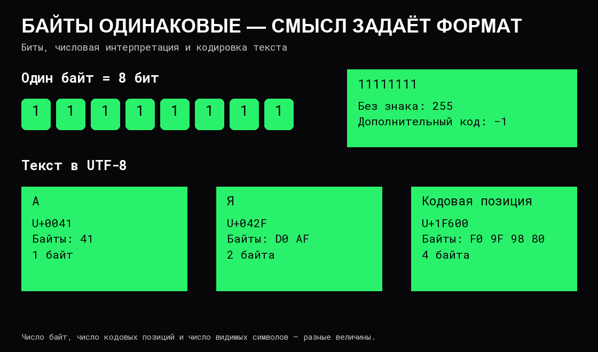

# Представление данных

Компьютер хранит и передаёт двоичные данные. Чтобы правильно прочитать их, нужно знать размер, формат и правила интерпретации.

## Биты, байты и единицы

**Бит** имеет два возможных значения: 0 и 1. **Байт** в современных системах состоит из 8 бит и допускает 256 различных комбинаций.

| Единица | Размер |
|---|---|
| 1 B, байт | 8 бит |
| 1 kB | 1000 байт |
| 1 KiB, КиБ | 1024 байта |
| 1 MB | 1 000 000 байт |
| 1 MiB, МиБ | 1 048 576 байт |
| 1 GiB, ГиБ | 1 073 741 824 байта |

При сравнении скорости сети и размера файла особенно легко перепутать биты и байты. Канал 1 Gbit/s имеет теоретический предел 125 MB/s до учёта протоколов и других расходов. Это расчёт единиц, а не обещанная скорость передачи.

## Целые числа

В двоичной записи позиции справа налево имеют веса 1, 2, 4, 8 и далее. Запись `1101` означает `8 + 4 + 0 + 1 = 13`. Для компактной записи байтов применяют **шестнадцатеричную систему**: цифры 0–9 и A–F обозначают значения 0–15. Одна такая цифра соответствует четырём битам, две — байту. Префикс `0x` указывает основание: `0x0D` — то же число 13.

В беззнаковом представлении из `n` бит можно хранить значения от 0 до `2ⁿ − 1`. Для 8 бит это 0–255, для 16 — 0–65 535.

Для отрицательных целых широко применяется **дополнительный код**. В `n` бит он представляет диапазон от `−2ⁿ⁻¹` до `2ⁿ⁻¹ − 1`. Старший бит имеет отрицательный вес: для 8 бит это −128, а остальные веса остаются 64, 32, 16, 8, 4, 2, 1. Так двоичная запись определяет отрицательные значения без отдельного байта знака.

Если результат вычисления не помещается в отведённое число бит, возникает **переполнение**. Например, математическое 255 + 1 требует девятого бита. Сохранение только младших 8 бит даст 0. Конкретный интерфейс может вместо этого обнаружить переполнение или применить другие правила: формат числа и реакция на ошибку — разные вопросы.

Это важно для размеров файлов, счётчиков, временных отметок и расчёта объёма буфера: входные значения могут помещаться по отдельности, а их произведение — уже нет.

## Числа с дробной частью

Двоичное число с плавающей точкой хранит знак, значащую часть и порядок. При конечном числе бит многие дроби представлены приближённо. Десятичное 0,1 не имеет конечной двоичной записи, как 1/3 не имеет конечной десятичной.

Поэтому вычисления могут округляться, порядок операций способен влиять на результат, а сравнение на точное равенство может не соответствовать прикладному смыслу. Нужную точность и допустимую погрешность определяют условия задачи. Для точного десятичного количества можно выбрать целое число минимальных единиц или десятичный формат с явно заданным масштабом.

У распространённых форматов IEEE 754 есть специальные значения: бесконечности и **NaN**, «не число». NaN может обозначать недопустимый результат вроде `0 / 0`; он не равен даже самому себе. При проверке внешних числовых данных важно отдельно требовать конечное допустимое значение.

## Текст и кодировка

**Unicode** задаёт кодовые позиции для представления текста. **UTF-8** задаёт способ записать их байтами: одна кодовая позиция занимает от 1 до 4 байт.

Видимый символ может состоять из нескольких кодовых позиций: например, буквы и отдельного комбинируемого знака. Такая воспринимаемая пользователем единица называется **графемным кластером**. Чтобы посчитать видимые символы, недостаточно просто посчитать кодовые позиции.

Обрезание текста по произвольному байту способно разорвать последовательность UTF-8. Ограничение «100 символов» нужно уточнять: это объём хранения, кодовые позиции или воспринимаемые пользователем символы?

## Порядок байтов

Многобайтовое число имеет порядок записи байтов — **endianness**. Число `0x1234` можно записать как `12 34` в big-endian или `34 12` в little-endian. При чтении [файла](../Операционные%20системы/05%20Файлы%20и%20системные%20вызовы.md) или сообщения следует использовать формат протокола, а не предполагать совпадение с устройством своей машины.

## Источники

[NIST — двоичные приставки](https://physics.nist.gov/cuu/Units/binary.html), [Unicode — UTF и порядок байтов](https://www.unicode.org/faq/utf_bom.html), [Unicode — графемные кластеры](https://unicode.org/reports/tr29/), [Дэвид Голдберг — арифметика с плавающей точкой](https://docs.oracle.com/cd/E19957-01/806-3568/ncg_goldberg.html).
