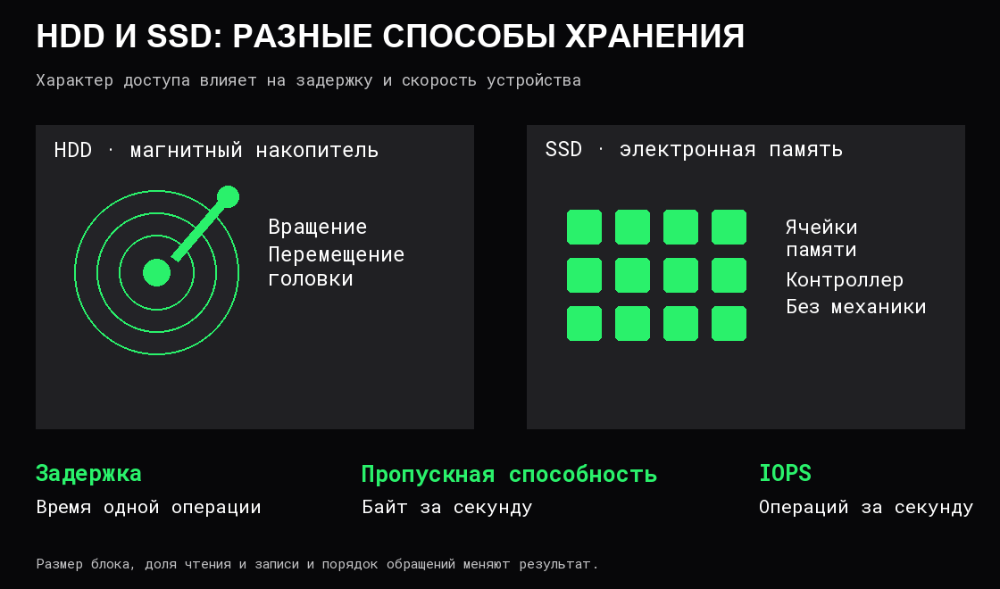

# Накопители и ввод-вывод

**Ввод-вывод, I/O**, — обмен данными с устройствами и внешним миром. Чтение файла, получение сетевых данных и отправка результата — разные операции ввода-вывода.

Накопитель хранит данные между запусками. Два распространённых вида — **HDD**, жёсткий диск, и **SSD**, твердотельный накопитель:

Отсутствие механики уменьшает часть задержек, но не делает SSD мгновенным или одинаково быстрым для всех операций.

## Как устройство взаимодействует с вычислением

**Контроллер** принимает команды и организует работу устройства. **Драйвер** — часть системного ПО, через которую ОС управляет конкретным классом оборудования.

ОС подготавливает операцию, устройство её выполняет, а затем о готовности результата нужно узнать. Два общих способа:

- **Опрос:** регулярно проверять состояние устройства. Частый опрос требует CPU, но при некоторых нагрузках бывает оправдан.
- **Прерывание:** оборудование сообщает о событии, после чего процессор выполняет соответствующий обработчик. Не обязательно по одному прерыванию на каждый байт или каждую операцию.

**DMA**, прямой доступ к памяти, позволяет устройству и контроллеру передавать данные в RAM или из неё без выполнения CPU отдельной инструкции копирования для каждого байта. Процессор всё равно участвует в подготовке, управлении и обработке результата. DMA само по себе не означает отсутствие всех копирований во всей системе.

## Что измерять

| Показатель | Какой вопрос решает |
|---|---|
| Размер блока | Какой объём приходится на одну операцию? |
| Доля чтения и записи | Какая смесь операций создаёт нагрузку? |
| Глубина очереди | Сколько запросов одновременно отправлено и ещё не завершено? |

IOPS сравнимы только при известных размере блока, характере доступа и доле чтения/записи. 10 000 операций по 4 KiB — около 39 MiB/s. То же число операций по 1 MiB означает совершенно другой объём работы.

**Последовательный доступ** идёт по соседним областям. **Случайный доступ** обращается к разным местам. Для HDD механические перемещения особенно важны. Для SSD характер доступа тоже влияет на работу контроллера и внутренней памяти.

## Почему очередь увеличивает задержку

Время операции для приложения включает ожидание очереди, обработку в ОС и устройстве, передачу данных и доставку результата. Рост [очереди](../Операционные%20системы/06%20Производительность.md) может помогать использовать параллелизм устройства до определённого предела; после насыщения дальнейший рост часто увеличивает ожидание.

Большой последовательный поток и множество маленьких случайных чтений могут давать совершенно разную задержку на одном накопителе. Результат теста «максимальные MB/s» не описывает все эти случаи.

Нужно также отделять завершение передачи в память от **устойчивого сохранения**. Между приложением и энергонезависимым носителем могут быть программные и аппаратные буферы. Какие действия подтверждают сохранность данных, задаёт контракт операции и устройства; успешная запись в обычный программный буфер этого не обещает.

Файлы, программные буферы и подтверждение сохранения разбираются в [файлах и системных вызовах](../Операционные%20системы/05%20Файлы%20и%20системные%20вызовы.md).

## Источники

[OSTEP — устройства ввода-вывода](https://pages.cs.wisc.edu/~remzi/OSTEP/file-devices.pdf), [жёсткие диски](https://pages.cs.wisc.edu/~remzi/OSTEP/file-disks.pdf), [SSD](https://pages.cs.wisc.edu/~remzi/OSTEP/file-ssd.pdf), [Linux — write](https://man7.org/linux/man-pages/man2/write.2.html), [Linux — fsync](https://man7.org/linux/man-pages/man2/fsync.2.html).
