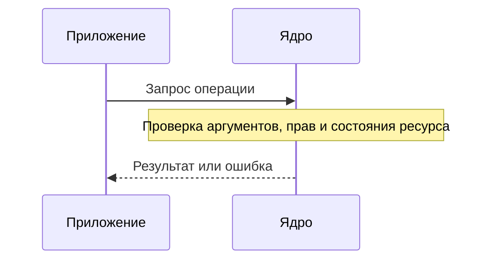

# Операционная система

**Операционная система, ОС**, организует выполнение программ, распределяет ресурсы компьютера и предоставляет средства работы с памятью, файлами и устройствами.

Без общего управления каждая программа могла бы занимать процессор неограниченно, менять чужую память и самостоятельно обращаться ко всем устройствам. ОС вместе с аппаратными механизмами ограничивает эти действия и позволяет программам работать совместно.

## Ядро и пользовательское пространство

**Ядро** — привилегированная часть ОС. Оно управляет процессами, отображениями памяти, устройствами и другими системными ресурсами. **Пользовательское пространство** — среда исполнения обычных приложений, служб и утилит.

Процессор поддерживает режимы с разными полномочиями. Обычное приложение не должно произвольно менять таблицы памяти или управлять оборудованием. Для разрешённых действий оно использует контролируемый интерфейс к ядру.

ОС не является интерпретатором каждой инструкции приложения: обычные вычисления выполняет непосредственно CPU. Участие ядра необходимо при определённых событиях и операциях.

## Системный вызов

**Системный вызов, syscall**, — запрос приложения к ядру: открыть файл, прочитать данные, создать отображение памяти, дождаться события.

Упрощённая последовательность:

Если операция не может закончиться сейчас, вызывающая задача может перейти в ожидание. В зависимости от интерфейса возможен и немедленный ответ «ресурс пока не готов».

**Смена режима** означает переход между пользовательским кодом и кодом ядра. **Переключение контекста** означает, что CPU продолжает другую задачу. Системный вызов не обязан приводить к переключению на другой поток.

## Изоляция и права

Процессу предоставляется своё адресное пространство — представление доступной ему памяти. Права доступа ограничивают разрешённые действия с файлами и другими объектами. Программа может получить отказ, даже если файл существует и накопитель исправен.

Изоляция допускает управляемое взаимодействие. Процессы могут обмениваться данными через каналы, сокеты или специально разделяемую память. Доступ должен быть предоставлен соответствующим механизмом; одинаковое числовое значение адреса в двух процессах этого не делает.

## ОС, виртуальная машина и контейнер

**Виртуальная машина** предоставляет гостевой системе виртуальное оборудование, на котором работает её собственная ОС. Управляет этим слоем гипервизор — механизм виртуализации.

**Контейнер** в обычной модели Linux — группа процессов с настроенной изоляцией и ограничениями, использующая ядро хоста. Образ файловой системы контейнера не является отдельным ядром.

В Linux **namespaces** задают отдельные представления ресурсов: например, процессов, сетевых интерфейсов и точек монтирования. **cgroups** организуют учёт и распределение ресурсов группы процессов. Изолировать видимость и ограничить расход CPU — разные задачи.

Поэтому приложение внутри контейнера может видеть собственное дерево процессов, но конкурировать за физический процессор с другими контейнерами. Отличия между ОС и механизмы контейнеризации не меняют основных ролей: выполнение, изоляция, обмен и распределение ресурсов.

## Какие вопросы относятся к ОС

Если программу не удалось запустить, не открывается файл, не хватает дескрипторов или задача долго не получает CPU, нужно рассматривать права, лимиты и состояние ресурсов. Изменение алгоритма вычисления само по себе не исправит запрет доступа или исчерпанную квоту.

Для конкретного интерфейса важна документация нужной ОС: общие принципы совпадают, названия и гарантии операций могут различаться.

## Источники

Проверены 28 октября 2026 года: [OSTEP — ограниченное прямое выполнение](https://pages.cs.wisc.edu/~remzi/OSTEP/cpu-mechanisms.pdf), [Linux — системные вызовы](https://man7.org/linux/man-pages/man2/syscalls.2.html), [namespaces](https://man7.org/linux/man-pages/man7/namespaces.7.html), [cgroup v2](https://docs.kernel.org/admin-guide/cgroup-v2.html).
