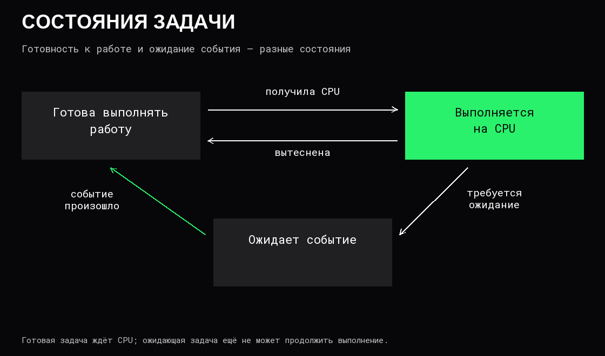
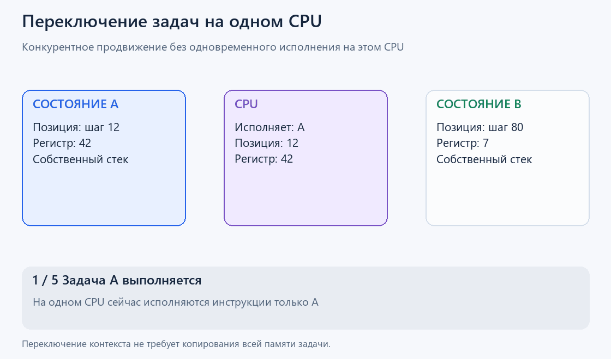

# Процессы и потоки

**Программа** — сохранённые инструкции и данные. **Процесс** — работающий экземпляр программы с адресным пространством, открытыми ресурсами и полномочиями. **Поток** — последовательность исполнения внутри процесса.

Один файл программы можно запустить несколько раз. Получатся отдельные процессы, даже если выполняемые инструкции одинаковые.

## Что общее, а что отдельное

В обычной модели многопоточного процесса:

| Общее для потоков | Состояние конкретного потока |
|---|---|
| Адресное пространство и данные | Положение в выполняемой программе |
| Динамически выделенная память | Состояние регистров |
| Многие открытые ресурсы | Собственный стек выполнения |

**[Стек](../Программы/03%20Вызовы%20функций%20и%20стек.md)** хранит состояние незавершённых вызовов и другую временную информацию исполнения. Собственный стек потока не означает аппаратный запрет другим потокам обращаться к этой области: они используют общее [адресное пространство](03%20Виртуальная%20память.md). Это разграничение организации работы, а не отдельная защита памяти.

Из-за общей памяти потоки удобно обмениваются данными, но могут повреждать их [несогласованными изменениями](04%20Конкурентность%20и%20синхронизация.md). Отдельные процессы по умолчанию имеют отдельные адресные пространства; для обмена используют специальные интерфейсы ОС.

## Состояния задачи и планировщик

**Планировщик** выбирает, какой готовой задаче предоставить CPU. Для понимания достаточно трёх состояний:



В Linux состояние `R` объединяет выполнение и готовность. `S` означает прерываемое ожидание, `D` — непрерываемое. `D` часто связано с вводом-выводом, но само по себе не доказывает неисправность диска. Буквы в выводе утилит описывают состояние задачи, а не причину задержки целиком.

При **вытеснении** система может прервать выполнение задачи и дать время другой. При **кооперативной** организации переключение опирается на передачу управления самой задачей. В реальных системах механизмы могут сочетаться на разных уровнях.

## Переключение контекста

Дополнительные затраты переключения могут возникнуть из-за кэшей и механизмов перевода адресов: после смены задачи ранее полезные записи могут уже не подходить новой работе.



Больше потоков не гарантирует больше полезной работы. Если все готовы вычислять, а доступных CPU мало, растут очереди и расходы координации. Если часть задач ожидает внешние события, другие могут использовать освободившийся CPU.

У стека потока нет универсального размера «всегда 8 МБ». Настройки ОС, резерв виртуальных адресов и фактически занятые физические страницы — разные величины. Оценивать расход тысяч потоков умножением на одну константу без этих условий некорректно.

## Жизненный цикл в Linux

`fork` создаёт дочерний процесс с новым идентификатором, **PID**. Частные страницы памяти обычно используют copy-on-write: физические данные разделяются до необходимости независимой записи. `execve` [заменяет программу текущего процесса](../Программы/01%20Компиляция,%20линковка%20и%20запуск.md), сохраняя его PID. Это две разные операции.

**Сигнал** — способ уведомить процесс или поток о событии. `SIGTERM` можно обработать и использовать для управляемого завершения. `SIGKILL` перехватить и обработать нельзя.

Без установленного обработчика обычное действие `SIGTERM` — завершение процесса. Несколько одинаковых стандартных сигналов могут объединяться в одно ожидающее уведомление, поэтому они не подходят для точного подсчёта событий. `SIGKILL` и `SIGSTOP` также нельзя заблокировать или игнорировать. Задача в непрерываемом ожидании может не завершиться немедленно даже после `SIGKILL`.

Управляемое завершение обычно означает прекратить приём новой работы, ограниченно подождать текущую и закрыть ресурсы. Сам сигнал не выполняет эту последовательность за приложение.

После завершения дочернего процесса родитель обычно получает его статус через `wait` или `waitpid`; существуют и настройки автоматического освобождения. Пока статус ожидает получения, запись остаётся как **зомби**, состояние `Z`. Зомби уже не исполняет инструкции и не удерживает обычное адресное пространство. Повторное принудительное завершение не освобождает эту запись.

## Посмотреть на работающий процесс

В Linux `1234` заменяется идентификатором интересующего процесса:

```bash
process_id=1234
ps -L -p "$process_id"
top -H -p "$process_id"
```

Первая команда показывает его потоки. Вторая позволяет наблюдать их активность: например, один постоянно занятый поток на фоне ожидающих. Число потоков показывает организацию исполнения, но не число одновременно доступных процессоров.

## Источники

[OSTEP — процесс](https://pages.cs.wisc.edu/~remzi/OSTEP/cpu-intro.pdf), [OSTEP — потоки](https://pages.cs.wisc.edu/~remzi/OSTEP/threads-intro.pdf), [pthreads](https://man7.org/linux/man-pages/man7/pthreads.7.html), [состояния задач](https://man7.org/linux/man-pages/man5/proc_pid_status.5.html), [fork](https://man7.org/linux/man-pages/man2/fork.2.html), [execve](https://man7.org/linux/man-pages/man2/execve.2.html), [wait](https://man7.org/linux/man-pages/man2/wait.2.html), [сигналы Linux](https://man7.org/linux/man-pages/man7/signal.7.html).
