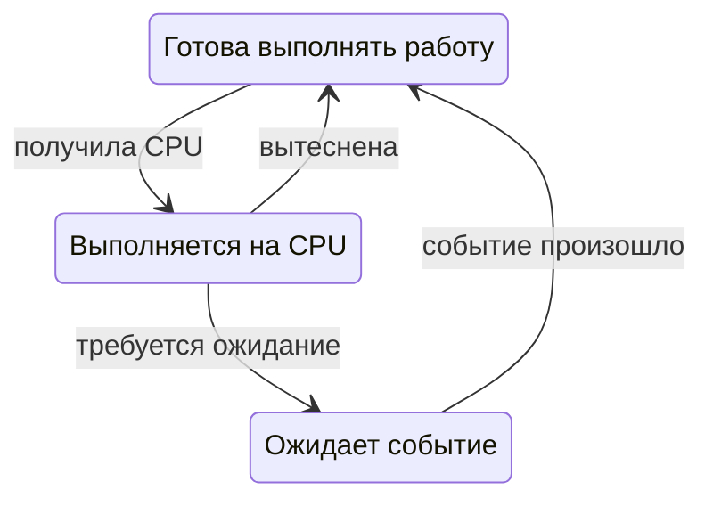

# Процессы и потоки

**Программа** — сохранённые инструкции и данные. **Процесс** — работающий экземпляр программы с адресным пространством, открытыми ресурсами и полномочиями. **Поток** — последовательность исполнения внутри процесса.

Один файл программы можно запустить несколько раз. Получатся отдельные процессы, даже если выполняемые инструкции одинаковые.

## Что общее, а что отдельное

В обычной модели многопоточного процесса:

| Общее для потоков | Состояние конкретного потока |
|---|---|
| Адресное пространство и данные | Положение в выполняемой программе |
| Динамически выделенная память | Состояние регистров |
| Многие открытые ресурсы | Собственный стек выполнения |

**Стек** хранит состояние незавершённых вызовов и другую временную информацию исполнения. Собственный стек потока не означает аппаратный запрет другим потокам обращаться к этой области: они используют общее адресное пространство. Это разграничение организации работы, а не отдельная защита памяти.

Из-за общей памяти потоки удобно обмениваются данными, но могут повреждать их несогласованными изменениями. Отдельные процессы по умолчанию имеют отдельные адресные пространства; для обмена используют специальные интерфейсы ОС.

## Состояния задачи и планировщик

**Планировщик** выбирает, какой готовой задаче предоставить CPU. Для понимания достаточно трёх состояний:



Готовая задача могла бы работать, но ждёт процессор. Ожидающая задача пока не может продолжить: ей нужны данные, снятие блокировки или наступление таймера. Эти причины задержки требуют разных действий.

При **вытеснении** система может прервать выполнение задачи и дать время другой. При **кооперативной** организации переключение опирается на передачу управления самой задачей. В реальных системах механизмы могут сочетаться на разных уровнях.

## Переключение контекста

Чтобы продолжить другую задачу, нужно сохранить часть состояния текущей и восстановить состояние следующей. Дополнительные затраты могут возникнуть из-за кэшей и механизмов перевода адресов. Переключение не означает копирование всей RAM процесса.

Больше потоков не гарантирует больше полезной работы. Если все готовы вычислять, а доступных CPU мало, растут очереди и расходы координации. Если часть задач ожидает внешние события, другие могут использовать освободившийся CPU.

У стека потока нет универсального размера «всегда 8 МБ». Настройки ОС, резерв виртуальных адресов и фактически занятые физические страницы — разные величины. Оценивать расход тысяч потоков умножением на одну константу без этих условий некорректно.

## Жизненный цикл в Linux

`fork` создаёт дочерний процесс; память часто разделяется с родителем по принципу copy-on-write, то есть копируется при необходимости записи. `execve` заменяет программу текущего процесса. Это две разные операции.

**Сигнал** — способ уведомить процесс или поток о событии. `SIGTERM` можно обработать и использовать для управляемого завершения. `SIGKILL` перехватить и обработать нельзя.

Управляемое завершение обычно означает прекратить приём новой работы, ограниченно подождать текущую и закрыть ресурсы. Сам сигнал не выполняет эту последовательность за приложение.

После завершения дочернего процесса родитель должен получить его результат. До этого запись о завершении может оставаться как **зомби**. Зомби уже не исполняет инструкции; повторное принудительное завершение не решает проблему получения результата.

## Посмотреть на работающий процесс

Примеры команд Linux, здесь не выполнялись. В `$PID` нужно подставить идентификатор интересующего процесса:

```bash
ps -L -p "$PID"
top -H -p "$PID"
```

Первая команда показывает его потоки. Вторая позволяет наблюдать их активность: например, один постоянно занятый поток на фоне ожидающих. Число потоков показывает организацию исполнения, но не число одновременно доступных процессоров.

## Источники

Проверены 28 октября 2026 года: [OSTEP — процесс](https://pages.cs.wisc.edu/~remzi/OSTEP/cpu-intro.pdf), [OSTEP — потоки](https://pages.cs.wisc.edu/~remzi/OSTEP/threads-intro.pdf), [pthreads](https://man7.org/linux/man-pages/man7/pthreads.7.html), [execve](https://man7.org/linux/man-pages/man2/execve.2.html), [сигналы Linux](https://man7.org/linux/man-pages/man7/signal.7.html).
