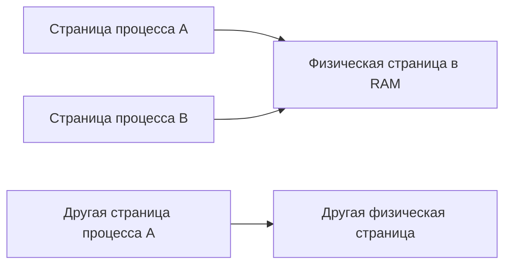

# Виртуальная память

**Виртуальная память** даёт процессу собственное представление доступных адресов. Адрес, используемый программой, не является прямым номером ячейки физической RAM. ОС и оборудование связывают виртуальные адреса с физическими данными и проверяют допустимость доступа.

Это позволяет изолировать процессы, управляемо разделять данные и держать в RAM только нужные сейчас части памяти. Виртуальная память не сводится к использованию диска вместо RAM.

## Страницы и таблицы отображения

Адресное пространство делится на **виртуальные страницы**, физическая память — на соответствующие блоки, или страничные кадры. Таблицы страниц задают отображения и права: например, разрешены ли чтение, запись и исполнение.

На многих системах базовая страница имеет размер 4 KiB, но возможны другие размеры и большие страницы. Размер нужно узнавать для конкретной системы.

Общая физическая страница может отображаться в несколько процессов. И наоборот, одинаковый числовой виртуальный адрес в разных процессах обычно может соответствовать разным данным.

Перевод адресов выполняется с поддержкой аппаратного блока управления памятью — **MMU**. **TLB** — небольшой аппаратный кэш результатов такого перевода. Промах TLB и отсутствие нужной страницы в RAM — разные события: промах кэша перевода не обязательно требует обращения к накопителю.

## Page fault

Если текущие условия не позволяют завершить обращение обычным образом, возникает **page fault**, исключение доступа к странице. ОС проверяет причину. Она может подготовить страницу и продолжить выполнение либо обнаружить недопустимый доступ.

Нормальные причины: первое обращение к ещё не подготовленной странице, загрузка файловых данных или создание частной копии. Поэтому page fault не обязательно означает ошибку программы.

В Linux **minor fault** обслуживается без чтения данных с накопителя, **major fault** требует такого ввода-вывода. Обращение к запрещённому адресу, напротив, может закончиться сигналом об ошибке. Сравнивать нужно частоту событий и задержки, а не только накопленное число.

**Выделение по требованию** означает, что резервирование диапазона адресов не обязано сразу занимать столько же RAM. При первом чтении и первой записи возможны разные действия ОС. В Linux overcommit дополнительно позволяет принимать некоторые обещания выделения сверх немедленно доступного обеспечения; это не гарантирует успех всех будущих обращений.

## Стек, куча и отображения

Это способы использования адресного пространства, а не разные физические устройства памяти:

- **Стек** организует состояние вложенных вызовов и временные данные исполнения.
- **Куча**, или область динамических выделений, обслуживает объекты с разными сроками жизни.
- **Файловое отображение** связывает диапазон адресов с данными файла.

Размещение, выделение и освобождение объектов организует программное обеспечение; ОС в основном управляет областями и страницами. Освобождение объекта внутри приложения не обязано сразу уменьшать объём его страниц в RAM: область может оставаться для повторного использования, а часть страницы — всё ещё содержать нужные данные.

## Copy-on-write и swap

**Copy-on-write, COW:** несколько пользователей временно разделяют данные, а при необходимости независимой записи создаётся копия. После создания дочернего процесса это может экономить память, пока стороны не меняют разделяемые страницы.

**Swap**, подкачка, позволяет хранить некоторые вытесненные данные вне RAM. Возврат требует дополнительной работы и способен сильно увеличить задержку. Неизменённую страницу обычного файла часто можно отбросить и затем перечитать из этого файла без swap.

Если нужные активные данные постоянно вытесняют друг друга, возникает интенсивное перемещение вместо полезной работы — **thrashing**. Добавление параллельной работы может его усугубить.

## Как читать объёмы памяти

| Показатель | Что означает |
|---|---|
| VIRT/VSZ | Объём виртуального адресного пространства, включая отображения и резервы |
| RSS | Объём учитываемых резидентных страниц процесса в RAM |
| PSS | Резидентный объём с пропорциональным разделением общих страниц |

Процесс с VSZ 8 GiB и RSS 200 MiB не обязательно использует 8 GiB физической памяти. Общие страницы могут учитываться в RSS сразу нескольких процессов, поэтому простая сумма RSS не равна уникально занятой RAM.

**OOM**, out of memory, означает невозможность удовлетворить определённую потребность в памяти в текущих условиях. В Linux причиной может быть как давление всей машины, так и лимит cgroup при ещё свободной памяти хоста. Сам по себе большой VSZ не доказывает утечку; нужны состав памяти и динамика нагрузки.

## Источники

Проверены 28 октября 2026 года: [OSTEP — адресные пространства](https://pages.cs.wisc.edu/~remzi/OSTEP/vm-intro.pdf), [страничная организация](https://pages.cs.wisc.edu/~remzi/OSTEP/vm-paging.pdf), [Linux — управление памятью](https://docs.kernel.org/admin-guide/mm/concepts.html), [smaps](https://man7.org/linux/man-pages/man5/proc_pid_smaps.5.html), [учёт minor/major faults](https://man7.org/linux/man-pages/man5/proc_pid_stat.5.html), [mmap](https://man7.org/linux/man-pages/man2/mmap.2.html), [cgroup v2](https://docs.kernel.org/admin-guide/cgroup-v2.html).
