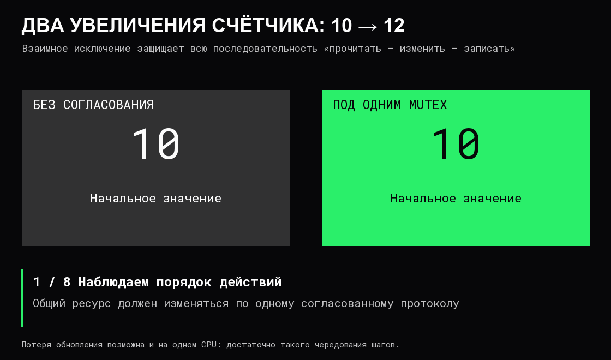

# Конкурентность и синхронизация

**Конкурентность** означает, что несколько задач продвигаются в пересекающиеся периоды времени. **Параллелизм** означает действительное одновременное исполнение работы на нескольких аппаратных исполнителях.

На одном CPU задачи могут чередоваться и быть конкурентными без параллельного выполнения инструкций. Несколько CPU позволяют параллелизм, но сам по себе запуск множества задач его не гарантирует: задачи могут ждать один ресурс.

## Синхронность — другой вопрос

**Синхронная операция** возвращает управление вызывающей стороне после выполнения предусмотренной контрактом работы. **Асинхронная** позволяет получить завершение позднее: через событие, уведомление или другой интерфейс.

Это описание взаимодействия, а не числа CPU. Асинхронная операция может не требовать отдельного потока на всё время ожидания. Несколько синхронных операций в разных потоках могут выполняться параллельно. Слово «синхронный» также само по себе не обещает устойчивую запись на накопитель — нужно читать контракт операции.

## Почему теряется обновление

Пусть общий счётчик равен 10, а две задачи должны увеличить его на единицу. Рассмотрим допустимое чередование отдельных действий:

| Шаг | Задача A | Задача B | Общее значение |
|---|---|---|---|
| 1 | Прочитала 10 | | 10 |
| 2 | | Прочитала 10 | 10 |
| 3 | Вычислила 11 | | 10 |
| 4 | | Вычислила 11 | 10 |
| 5 | Записала 11 | | 11 |
| 6 | | Записала 11 | 11 |

Ожидалось 12, получилось 11. Для такой потери обновления достаточно переключений на одном CPU. Быстрая RAM, когерентные кэши и маленькое число не делают всю последовательность неделимой.

**Гонка данных** связана с несогласованными конфликтующими обращениями к общей памяти, среди которых есть запись. **Гонка условий, race condition**, — более широкая зависимость корректности от порядка событий. Например, две по отдельности корректные операции «проверить наличие» и «создать» могут вместе нарушить требование «создать ровно один объект».

## Чем защищают общее состояние

**Критическая секция** — участок, в котором нужно согласованно работать с общими данными.

- **Mutex** допускает в защищённую секцию одного владельца. Все конфликтующие обращения должны следовать одному протоколу защиты.
- **Атомарная операция** выполняет определённое изменение неделимо относительно соответствующих обращений. Неделимое увеличение одного счётчика не делает автоматически неделимым обновление нескольких связанных полей.
- **Семафор** управляет количеством разрешений. Например, 10 разрешений ограничивают число одновременно выполняемых операций до 10.
- **Условная переменная** позволяет ожидать изменения условия. Проверка самого условия выполняется под согласованной защитой и повторяется после пробуждения: уведомление ещё не означает, что ресурс достанется именно этому ожидающему.

Синхронизация также задаёт порядок публикации и наблюдения данных. Недостаточно рассуждать только о том, когда «обновится кэш»: нужны гарантии конкретного механизма обмена.

Другой подход — назначить состоянию одного владельца и передавать ему запросы через ограниченную очередь. Это уменьшает число мест, меняющих данные, но требует определить вместимость очереди и поведение при переполнении.

## Ожидание и активное вращение

При блокирующем ожидании задача перестаёт быть готовой к исполнению до события. При **активном ожидании, spin**, она продолжает проверять условие и расходовать CPU.

Короткое активное ожидание иногда оправдано, если переключение дороже ожидаемого освобождения ресурса. Для долгого ожидания сети или диска оно обычно создаёт лишнюю нагрузку. Универсального правила «всегда крутиться» или «всегда засыпать» нет.

## Deadlock, starvation и livelock

**Взаимная блокировка, deadlock:** A удерживает ресурс X и ждёт Y, B удерживает Y и ждёт X. Продолжить не может никто. Единый порядок захвата ресурсов помогает предотвратить такой цикл; сокращение времени удержания уменьшает конкуренцию.

**Голодание, starvation:** задача долго не получает необходимый ресурс, хотя другие продолжают работу. **Livelock:** участники активно реагируют друг на друга, но полезного продвижения не происходит.

Ограничение времени ожидания помогает обнаружить зависание, но само по себе не делает алгоритм корректным: нужно решить, как освобождать ресурсы и что делать с частично выполненной работой.

## Источники

[OSTEP — введение в конкурентность](https://pages.cs.wisc.edu/~remzi/OSTEP/threads-intro.pdf), [блокировки](https://pages.cs.wisc.edu/~remzi/OSTEP/threads-locks.pdf), [условные переменные](https://pages.cs.wisc.edu/~remzi/OSTEP/threads-cv.pdf).
