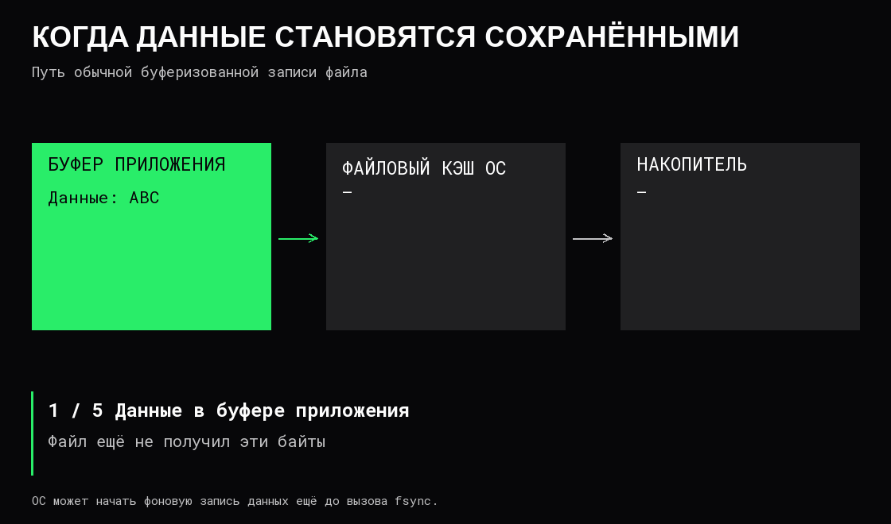

# Файлы и системные вызовы

**Файловая система** организует хранение файлов, имён, каталогов и метаданных на устройстве или другом источнике хранения. Программа использует операции ОС, а не самостоятельно решает, в какие физические ячейки накопителя писать каждый байт.

Общие понятия применимы широко; имена вызовов, дескрипторы и детали ниже относятся к Linux и близким Unix-системам.

## Имя, файл и открытый дескриптор

**Путь** позволяет найти объект через каталоги. **Файловый дескриптор, FD**, — номер в таблице ресурсов процесса, полученный при открытии объекта. Он может обозначать не только обычный файл, но и сокет, канал или объект ожидания событий.

**Inode** хранит метаданные файла: тип, размер, владельца, права и сведения о размещении данных. Имя хранится в записи каталога, которая указывает на inode. **Жёсткая ссылка** — ещё одно имя того же файла в той же файловой системе. **Символическая ссылка** — отдельный объект с путём к цели; она может вести в другую файловую систему или указывать на уже несуществующий путь.

Открытое описание файла содержит состояние, например текущую позицию чтения. Два отдельных открытия обычно получают независимые позиции. Дублирование дескриптора может дать два номера, ссылающихся на одно описание с общей позицией.

Удаление имени файла не всегда немедленно освобождает данные. В Unix данные могут оставаться доступны через открытые дескрипторы или отображения; другие имена файла тоже могут сохранять доступ. Поэтому удалённый из каталога лог иногда продолжает занимать место, пока процесс его удерживает.

После закрытия номер FD может быть повторно использован для другого объекта. Это не постоянный идентификатор файла. Незакрытые ресурсы накапливаются; исчерпание лимита дескрипторов может помешать открыть новое соединение или записать очередной лог.

В Linux `EMFILE` обычно означает исчерпание лимита дескрипторов процесса, `ENFILE` — системного предела открытых файлов. После `fork` унаследованные FD разделяют открытые описания с родителем. При `execve` дескрипторы сохраняются, кроме помеченных `FD_CLOEXEC`. Флаг `O_CLOEXEC` при открытии позволяет сразу запретить такое наследование, избегая промежутка между открытием и отдельной установкой флага.

## Путь и права доступа

Абсолютный путь отсчитывается от корня доступной процессу файловой иерархии, относительный — от выбранного текущего каталога или другого указанного основания. Одинаковая строка относительного пути может обозначать разные файлы в разных окружениях.

Доступ к файлу зависит и от возможности пройти по каталогам его пути. В Linux право `x` для каталога разрешает поиск и проход через него, а не запуск каталога. Разрешение прочитать сам файл ещё не даёт автоматического права пройти все родительские каталоги. Проверять нужно полномочия фактически работающего процесса.

Базовые права `r/w/x` задаются для владельца, группы и остальных. У обычного файла это чтение, изменение и исполнение. У каталога `r` разрешает перечисление имён, `w` вместе с `x` — изменение записей, `x` — поиск по имени. Удаление имени обычно определяется правами каталога, а не правом записи в сам файл.

Дополнительно могут действовать списки доступа, **ACL**, с правами конкретных пользователей и групп. Флаг **sticky bit** на общем каталоге ограничивает удаление чужих файлов даже при праве записи в каталог. Режим файловой системы только для чтения и политики безопасности также могут запретить операцию.

## Чтение и запись могут быть частичными

Чтение и запись возвращают фактически обработанный объём, а не обязуются всегда выполнить весь запрошенный размер за один вызов.

Запрос «прочитать до 4096 байт» может вернуть 512 байт. Это не обязательно ошибка. Данные обрабатываются в полученном объёме, а продолжение определяется форматом и причиной завершения операции.

При запросе хотя бы одного байта нулевой результат чтения обычного файла означает конец доступных данных в текущей позиции, а потокового сокета — корректное завершение входного потока другой стороной. Запрос нулевой длины может вернуть 0 без достижения конца. **Датаграмма** — отдельное сообщение — также может иметь нулевую длину: переносить на неё правило потокового сокета нельзя.

Частичную запись нужно продолжать с оставшейся части. `EINTR` означает прерывание сигналом до передачи данных для этих вызовов; после передачи части они могут вернуть её размер. Решение о повторе зависит от контракта операции и отмены работы. Не следует безусловно повторять любую системную операцию целиком.

## Блокирующий и неблокирующий режим

В **блокирующем режиме** операция может приостановить вызывающий поток, пока не появятся нужные условия. В **неблокирующем** неподготовленный ресурс обычно даёт немедленный результат вроде `EAGAIN`: сейчас продолжать нечем.

Неблокирующая операция не означает, что вся прикладная работа завершится мгновенно. Приложению по-прежнему нужно хранить состояние незавершённого обмена и позже продолжить его.

В Linux `O_NONBLOCK` не устраняет ожидание накопителя при доступе к обычному файлу. Для такого файла `epoll` обычно не поддерживает регистрацию и возвращает `EPERM`. Модель неблокирующих сокетов нельзя автоматически применять к файловому вводу-выводу.

**Готовность** означает возможность попробовать операцию. **Завершение** означает, что конкретная операция закончилась. Это разные модели уведомления.

В Linux `epoll` позволяет зарегистрировать интерес к событиям на множестве дескрипторов и ждать готовые. Событие не обещает наличие целого прикладного сообщения. После уведомления операция всё ещё может получить частичный результат или `EAGAIN`.

При уведомлениях по уровню готовность может сообщаться повторно, пока сохраняется условие. При уведомлениях по переходу к готовности важно обрабатывать доступное до `EAGAIN`, конца потока или ошибки; иначе можно оставить данные без нового события. Ожидание готовности к записи следует включать, когда есть что отправлять: постоянно готовый сокет иначе может создавать пустой цикл и расходовать CPU.

## Буфер приложения, page cache и накопитель

**Буферизация** собирает несколько мелких порций данных в более крупную. Это способ уменьшить число операций ценой памяти и возможного дополнительного ожидания.

Это типичный путь буферизованной файловой записи; существуют другие режимы. Один вызов может переместить данные только на очередной этап.

**Page cache** — файловые страницы в RAM. Неизменённые страницы при необходимости можно отбросить и позже перечитать. Изменённые, или **dirty**, нужно сначала сохранить. Повторное чтение файла может обслуживаться из RAM и потому не измерять скорость накопителя.

Ошибки записи могут обнаружиться позднее, при `fsync` или закрытии файла. Результаты этих операций нужно проверять; после ошибки нельзя считать данные сохранёнными.

Синхронизация файла не обязательно сохраняет изменение записи о его имени в родительском каталоге: для этого может требоваться отдельная синхронизация каталога. Ни закрытие файла, ни операция «сбросить буфер приложения» не следует автоматически приравнивать к `fsync`.

## Атомарная замена и устойчивость к сбою

В Linux `rename` может атомарно заменить имя назначения в пределах одной файловой системы: читатель, открывающий это имя, получает прежний или новый файл, без промежуточного отсутствия имени. Уже открытый дескриптор продолжает указывать на прежний объект. Перезапись содержимого существующего файла по частям такой гарантии не даёт.

Для замены файла с сохранением при сбое питания обычно создают временный файл в том же каталоге, полностью записывают его, успешно выполняют `fsync` файла, заменяют имя через `rename`, затем синхронизируют каталог. Каждая ошибка требует обработки. Атомарная видимость замены и её устойчивость к потере питания — разные свойства; конкретные гарантии зависят от файловой системы и оборудования.

## Ограничение незавершённой работы

Если отправитель формирует данные быстрее, чем получатель принимает, выходная очередь растёт. Механизм готовности сам по себе не задаёт предел памяти этой очереди.

**Обратное давление, backpressure**, — ограничение приёма или создания новой работы, когда следующий этап не успевает. Дополнительно нужны пределы размера буфера и времени ожидания. Иначе даже корректный обмен с медленным получателем способен исчерпать память.

## Источники

[open](https://man7.org/linux/man-pages/man2/open.2.html), [inode](https://man7.org/linux/man-pages/man7/inode.7.html), [ссылки на файлы](https://man7.org/linux/man-pages/man7/symlink.7.html), [разрешение путей](https://man7.org/linux/man-pages/man7/path_resolution.7.html), [read](https://man7.org/linux/man-pages/man2/read.2.html), [recv](https://man7.org/linux/man-pages/man2/recv.2.html), [write](https://man7.org/linux/man-pages/man2/write.2.html), [close](https://man7.org/linux/man-pages/man2/close.2.html), [epoll](https://man7.org/linux/man-pages/man7/epoll.7.html), [epoll_ctl](https://man7.org/linux/man-pages/man2/epoll_ctl.2.html), [fsync](https://man7.org/linux/man-pages/man2/fsync.2.html), [rename](https://man7.org/linux/man-pages/man2/rename.2.html), [Linux — page cache](https://docs.kernel.org/admin-guide/mm/concepts.html).
