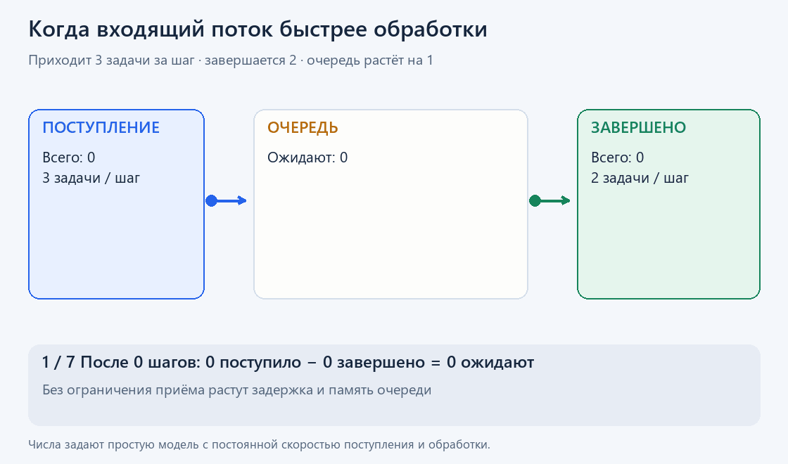

# Производительность: вычисление, ожидание и очереди

Производительность нужно оценивать для конкретной работы и нагрузки. Время одной операции и число операций в секунду отвечают на разные вопросы.

**Задержка** — время от начала до завершения выбранной операции. **Пропускная способность** — объём завершённой работы за единицу времени. **Занятость ресурса** показывает, какую долю интервала он работал. **Насыщение** означает, что спрос создаёт ожидание этого ресурса.

## Из чего складывается время

Для последовательного пути можно разложить задержку на ожидание очереди, получение CPU, вычисление, ожидание данных и другие этапы. Если этапы перекрываются, их длительности нельзя просто складывать: важен путь, определяющий момент завершения.

**CPU-bound** — задача преимущественно ограничена вычислительной мощностью. **I/O-bound** — временем получения или передачи данных. Также возможны ограничения пропускной способности RAM, синхронизации или внешнего ресурса.

Свободный CPU не доказывает, что ускорять нечего: задача может ждать диск, сетевой ответ, блокировку или разрешение начать работу. Занятый CPU тоже не доказывает полезный прогресс: активное ожидание и повторные неудачные попытки расходуют время.

## Почему среднее скрывает проблему

Средняя загрузка всей машины может скрывать одно полностью занятое ядро. Средняя задержка может скрывать редкие долгие операции.

**p99 задержки** — значение, не превышаемое примерно 99% измеренных операций. Оставшаяся доля может быть значительно медленнее. Для интерпретации нужны количество наблюдений, интервал и способ измерения. Если измеритель не включает время очереди или перестаёт посылать работу во время зависания, картина может оказаться слишком благоприятной.

## Очередь связывает нагрузку, задержку и память



Даже без роста среднего времени обработки задержка новых задач растёт из-за накопленного ожидания. Сравнение только времени внутри обработчика этого не покажет.

В устойчивой системе среднее число операций внутри неё связано с потоком и средним временем — **закон Литтла**:

**число операций ≈ операций в секунду × секунд на операцию.**

Например, при 500 операциях в секунду и среднем времени 80 ms одновременно внутри системы находится в среднем 40 операций. Сюда входят и выполняемые, и ожидающие. Если каждая удерживает 1 MiB данных, только эти данные займут около 40 MiB без учёта других расходов.

Такой расчёт требует устойчивого режима и одинаковой границы измерения. При бесконечно растущей очереди простая подстановка кратковременных средних вводит в заблуждение.

## Больше исполнителей помогает до границы ресурса

Дополнительные исполнители могут использовать свободные CPU или перекрыть ожидание. После насыщения следующего ресурса они способны лишь увеличить очередь, память и конкуренцию.

Прежде чем повышать параллелизм, нужно понять, чего именно ждут задачи и какой ресурс получит дополнительную нагрузку. Ограниченная очередь даёт возможность явно отказать или замедлить приём работы вместо неограниченного роста задержки.

## Ограничения контейнера

В Linux квота CPU задаёт бюджет процессорного времени за период, а не обязательно отдельное физическое ядро. В идеализированном примере бюджет 100 ms на период 100 ms можно потратить одним исполнителем за весь период или четырьмя за 25 ms. После исчерпания бюджета группе придётся ждать — **throttling**.

Свободные CPU хоста не отменяют установленную квоту. Для памяти тоже важен лимит группы, а не только свободная RAM всей машины.

## Показатели Linux, которые легко перепутать

В учёте CPU `user` — исполнение пользовательского кода, `system` — кода ядра. `steal` показывает время, когда виртуальный CPU не получил физический процессор от гипервизора. `iowait` — особая категория учёта простоя при незавершённом I/O; это не точное время ожидания диска конкретным процессом и не самостоятельное доказательство проблемы накопителя.

**Load average** — сглаженное число выполняемых и готовых задач плюс задач в непрерываемом ожидании. Три значения показывают тенденцию с масштабами около 1, 5 и 15 минут. Это число задач, а не процент CPU: load может вырасти при почти свободном процессоре из-за ожидания I/O. Сопоставлять его нужно с состояниями задач, доступными CPU и квотой; load всего хоста нельзя точно пересчитать в загрузку одного контейнера.

## Минимальная проверка на Linux

Нужны соответствующие утилиты Linux и доступ к исследуемому процессу. `1234` заменяется его реальным идентификатором.

```bash
process_id=1234
pidstat -t -u -r -w -p "$process_id" 1 5
vmstat 1 5
cat /proc/"$process_id"/smaps_rollup
```

| Наблюдение | Как использовать |
|---|---|
| CPU процесса и потоки | Найти, где реально выполняется работа; среднее сравнить с отдельными CPU |
| Переключения контекста | Увидеть изменение поведения; большое число само по себе не доказывает проблему |
| Очередь `r` в `vmstat` | Оценить число готовых к выполнению задач вместе с доступными CPU |
| `si`/`so` | Посмотреть активность подкачки за интервалы |
| RSS/PSS в `smaps_rollup` | Разобрать резидентную память и вклад разделяемых страниц |

Первая строка `vmstat` обычно содержит усреднение с момента загрузки; последующие относятся к интервалам наблюдения. `smaps_rollup` доступен не во всех окружениях.

Малое `MemFree` не равно нехватке RAM: часть занята файловым кэшем. В Linux `MemAvailable` оценивает объём, доступный для новой работы без подкачки. В контейнере дополнительно нужны данные его собственного учёта памяти.

## Проверка гипотезы

1. Зафиксировать операцию, объём данных, входную нагрузку и границы измерения.
2. Разделить выполнение и ожидание. Профиль исполняемого кода не описывает автоматически время ожидания.
3. Найти ограничивающий ресурс и сформулировать ожидаемый эффект одного изменения.
4. Повторить измерение в сопоставимых условиях; проверить не только скорость, но и ошибки, задержки и память.

Тёплые кэши, изменившиеся данные или меньшая нагрузка могут объяснить ускорение без улучшения самого решения. Средство измерения тоже добавляет расходы.

## Источники

[pidstat](https://man7.org/linux/man-pages/man1/pidstat.1.html), [vmstat](https://man7.org/linux/man-pages/man8/vmstat.8.html), [smaps](https://man7.org/linux/man-pages/man5/proc_pid_smaps.5.html), [meminfo](https://man7.org/linux/man-pages/man5/proc_meminfo.5.html), [учёт CPU](https://man7.org/linux/man-pages/man5/proc_stat.5.html), [load average](https://man7.org/linux/man-pages/man5/proc_loadavg.5.html), [cgroup v2](https://docs.kernel.org/admin-guide/cgroup-v2.html), [Джон Литтл — связь потока, времени и числа задач](https://pubsonline.informs.org/doi/10.1287/opre.9.3.383).
