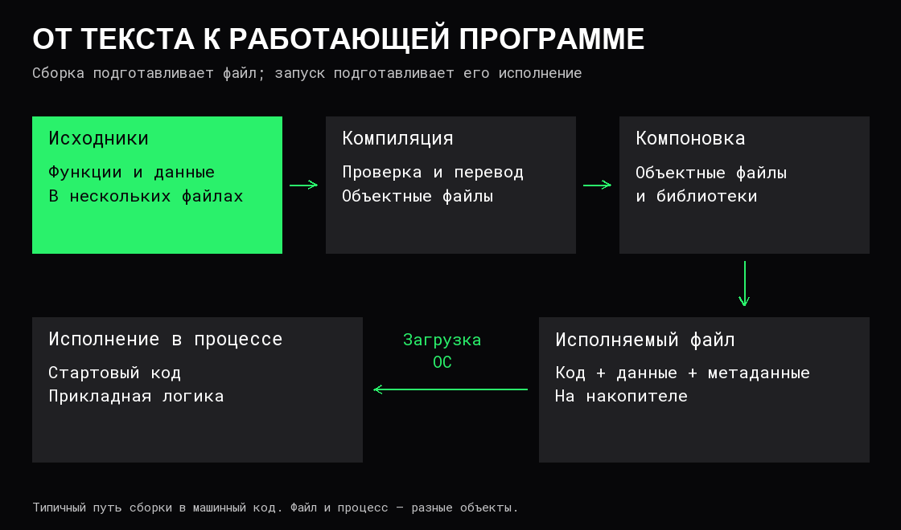

# Компиляция, линковка и запуск

Исходный код описывает программу на языке программирования: её данные, операции и связи между частями. [Процессор](../Компьютер/03%20Процессор.md) выполняет машинные инструкции своей архитектуры. Между исходным текстом и выполнением находится цепочка преобразований.

**Компилятор** переводит программу из одного представления в другое. Результатом может быть машинный код, промежуточный код или код другого языка. Ниже сначала рассматривается типичный путь получения отдельного исполняемого файла с машинным кодом.

**Сборка** — подготовка результата из исходников и зависимостей. Она может включать генерацию файлов, компиляцию, обработку ресурсов и **линковку**, или компоновку, — соединение подготовленных частей программы. **Запуск** — подготовка и начало её исполнения средствами ОС.



## От выражения к инструкциям

Условная программа получает два числа, складывает их и выводит результат. Псевдокод показывает только смысл, без синтаксиса конкретного языка:

```text
первое = прочитать число
второе = прочитать число
результат = первое + второе
вывести результат
```

Компилятор должен определить, где объявлены значения, что означает сложение и как вызвать операции чтения и вывода. Для введённых чисел 2 и 3 результатом будет 5. Но одной машинной инструкции, соответствующей всей строке «вывести результат», обычно нет: требуются преобразование числа в текст и обращение к средствам вывода.

### Разбор и проверка

Сначала текст разбивается на **токены** — значимые элементы: имена, числа, знаки операций. Затем из них строится структура выражений и команд. **AST**, абстрактное синтаксическое дерево, показывает, например, что операция сложения имеет два операнда, а её результат используется в присваивании.

После разбора проверяется смысл конструкций: существуют ли используемые имена, допустимы ли операции, соответствуют ли аргументы требованиям функции. Набор проверок зависит от языка. В языке со статической проверкой типов попытка передать строку вместо требуемого числа может быть обнаружена до запуска.

Синтаксически правильная программа не обязательно правильна по смыслу задачи. Компилятор может принять вычитание вместо сложения: такая операция допустима, хотя разработчик выбрал её ошибочно.

### Промежуточный код и оптимизации

Внутри компилятора программа часто преобразуется в **IR** — промежуточное представление, удобное для анализа операций и зависимостей. Оно отделяет особенности исходного языка от выбора инструкций процессора.

На этом представлении выполняются **оптимизации** — преобразования с сохранением поведения, требуемого правилами языка. Например, известное заранее выражение `2 + 3` можно заменить числом `5`, а недостижимую ветку — удалить. В примере с вводом чисел их значения заранее неизвестны, поэтому заменить сложение постоянным результатом нельзя.

**Встраивание функции**, или inlining, заменяет вызов её телом в месте использования. Это может убрать расходы вызова и открыть другие оптимизации, но увеличить объём кода. Отдельная функция в исходнике поэтому не обязательно остаётся отдельным вызовом в результате сборки. Конкретные решения зависят от инструментов, параметров и программы.

### Машинный код и объектный файл

Генератор кода выбирает инструкции целевой архитектуры, регистры и способы доступа к данным. Одна операция исходника может требовать нескольких инструкций; некоторые операции после оптимизации исчезают.

Возможен промежуточный текст на **ассемблере** — символьная запись машинных инструкций. **Ассемблер** как инструмент кодирует эту запись в машинные команды. Компилятор также может формировать машинный код без отдельного текстового файла ассемблера.

Результат отдельной компиляции часто сохраняется в **объектном файле**. Кроме кода и данных, он содержит сведения об именах и ссылках, которые ещё предстоит связать. Обычно такой файл нельзя запустить как законченную программу.

## Что связывает компоновщик

Допустим, один исходный файл содержит обработку ввода, а другой — функцию расчёта. Их можно скомпилировать отдельно. В первом объектном файле останется обращение к функции, реализация которой находится во втором.

Именованную функцию или объект данных в этом контексте называют **символом**. Компоновщик сопоставляет ссылки на символы с их определениями и объединяет нужные части программы. Записи **релокации** указывают, какие обращения необходимо скорректировать с учётом итогового размещения кода и данных. Например, адрес функции может стать известен лишь после размещения её в результате сборки.

**Библиотека** предоставляет код, используемый другими частями программы. Компоновщик может получать код как из отдельных объектных файлов, так и из библиотек. Если необходимое определение найти невозможно, сборка может завершиться ошибкой неразрешённого символа.

При **статической компоновке** нужный библиотечный код включается в результат сборки. При **динамической компоновке** часть зависимостей сохраняется как ссылки на разделяемые библиотеки, которые подготавливаются к использованию при запуске или во время работы. Некоторые ссылки на функции разрешаются только при первом обращении.

Эти способы могут сочетаться в одном файле. Наличие одного исполняемого файла само по себе не доказывает, что его можно перенести на любую машину: остаются требования к ОС, библиотекам и внешним данным.

Граница между компиляцией и линковкой не всегда жёсткая. При **LTO**, оптимизации во время компоновки, инструменты используют промежуточное представление нескольких частей программы, чтобы оптимизировать их совместно.

## Что находится в исполняемом файле

Исполняемый файл содержит код, начальные данные и сведения для загрузки: какие области памяти подготовить, с какими правами, откуда начать выполнение, какие внешние библиотеки потребуются. В Linux распространён формат **ELF**, в Windows — **PE**.

**Точка входа** — адрес, которому передаётся управление после подготовки загрузки. Она не обязана совпадать с первой функцией, написанной разработчиком. Сначала может выполняться стартовый код: подготовка окружения, библиотек и среды выполнения, затем прикладная логика.

**Среда выполнения**, или runtime, — код, обслуживающий выполнение программы. В зависимости от реализации она может обеспечивать управление памятью, обработку исключений и другие механизмы. Её состав и способ поставки зависят от языка и инструментов; отдельная большая среда выполнения нужна не каждой программе.

**Целевая платформа** определяется не только набором инструкций процессора. Важны ОС и **[ABI](03%20Вызовы%20функций%20и%20стек.md)** — двоичные соглашения о вызовах, передаче аргументов, размещении данных и взаимодействии компонентов. Совпадение архитектуры CPU не делает файл для одной ОС готовым файлом для другой.

## Как файл начинает выполняться

Файл на накопителе и **[процесс](../Операционные%20системы/02%20Процессы%20и%20потоки.md)**, в котором программа выполняется, — разные объекты. Один файл можно запустить несколько раз: у экземпляров будут свои адресные пространства и состояние, хотя ОС может разделять между ними неизменяемые страницы кода.

На модели Linux подготовка запуска включает следующие действия:

1. Оболочка или другая программа обращается к ОС для исполнения файла. Системный вызов `execve` заменяет программу вызывающего процесса новой; сам по себе новый процесс не создаёт. Для отдельного запуска оболочка обычно предварительно создаёт дочерний процесс.
2. Ядро проверяет файл и права, подготавливает отображения кода и данных в [виртуальную память](../Операционные%20системы/03%20Виртуальная%20память.md), начальный стек, аргументы и переменные окружения. Все страницы не обязаны немедленно попадать в RAM: они могут подгружаться по обращению.
3. Если требуется динамический загрузчик, он находит необходимые библиотеки, загружает их и связывает обращения. Отсутствие библиотеки или нужного символа может помешать запуску до прикладной логики.
4. Управление получает стартовый код, а после необходимой инициализации — прикладной код. Процессор исполняет инструкции тогда, когда планировщик выделяет процессорное время его потоку.

Изменение исходника не меняет уже собранный файл. Повторная сборка тоже сама по себе не заменяет программу в работающем процессе. Применение новой версии требует её запуска либо специально предусмотренного механизма обновления.

## Интерпретация, байткод и JIT

Не каждая программа проходит весь путь до отдельного файла с машинным кодом заранее. **Интерпретатор** исполняет представление другой программы: например, обходит её структуру или выполняет инструкции **байткода** — кода для программной машины.

При **AOT-компиляции** машинный код подготавливается до запуска. При **JIT-компиляции** перевод в машинный код происходит во время работы, иногда только для часто выполняемых участков. Одна система может сочетать компиляцию исходника в байткод, его интерпретацию и JIT-компиляцию.

Различие относится к способу исполнения конкретной реализацией. Интерпретатор сам является выполняемой программой: процессор исполняет его машинные инструкции, а тот определяет действия по представлению пользовательской программы. При JIT процессор также исполняет сгенерированный машинный код.

## Что организует система сборки

В большой программе нужно учитывать порядок зависимостей: какая часть использует другую и что изменилось. **Система сборки** организует вызовы инструментов и получение итогового результата. Одна внешняя команда может скрывать множество этапов; успешное завершение отдельного этапа ещё не означает готовность всей программы.

**Инкрементальная сборка** повторяет только работу, ставшую необходимой после изменений. **Кэш сборки** позволяет использовать подходящие ранее полученные результаты. Для этого необходимо учитывать не только исходники, но и зависимости, настройки и версию инструментов. Ускорение повторной сборки не означает ускорения самой программы.

Сборка для платформы, отличающейся от той, где работают инструменты, называется **кросс-компиляцией**. Одного выбора архитектуры недостаточно: могут понадобиться библиотеки и другие компоненты целевой системы.

## Где возникают ошибки

| Наблюдение | Возможный участок проблемы |
|---|---|
| Недопустимая конструкция, неизвестное имя, несовместимые типы | Разбор и проверка исходника |
| Не найден исходник или зависимость | Подготовка сборки |
| Не найдено определение требуемого символа | Компоновка, иногда динамическое связывание |
| ОС отказывает в исполнении | Права, формат файла, целевая платформа или загрузчик |
| Отсутствует разделяемая библиотека | Подготовка динамических зависимостей |
| Программа запустилась, но работает неверно | Инициализация или прикладная логика |
| После изменения выполняется старая версия | Какой файл собран и какая версия запущена |

Успешная сборка подтверждает прохождение проверок инструментов. Правильность расчётов, доступность внешних ресурсов и поведение под нагрузкой требуют отдельных оснований.

## Источники

- [GCC: этапы получения результата сборки](https://gcc.gnu.org/onlinedocs/gcc/Overall-Options.html).
- [Clang: разбор, проверка, генерация кода, ассемблирование и линковка](https://clang.llvm.org/docs/CommandGuide/clang.html).
- [LLVM: оптимизация во время компоновки](https://llvm.org/docs/LinkTimeOptimization.html).
- [ccache: повторное использование результатов компиляции](https://ccache.dev/manual/latest.html).
- [ELF: устройство объектных и исполняемых файлов, символы и релокации](https://man7.org/linux/man-pages/man5/elf.5.html).
- [Microsoft: формат PE и COFF](https://learn.microsoft.com/en-us/windows/win32/debug/pe-format).
- [Linux: замена программы процесса через execve](https://man7.org/linux/man-pages/man2/execve.2.html).
- [Linux: динамический загрузчик](https://man7.org/linux/man-pages/man8/ld.so.8.html).
- [V8: пример совместной работы интерпретатора и компилятора](https://v8.dev/blog/launching-ignition-and-turbofan).
