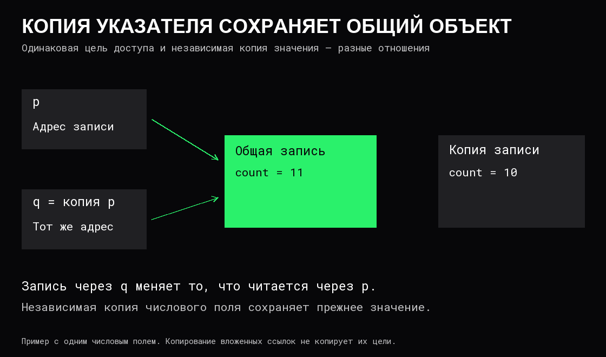

# Значения, типы и указатели

**Значение** — данные, с которыми выполняется операция: число, признак, запись, последовательность элементов. **Тип** определяет допустимые значения и операции над ними. Одни и те же байты могут интерпретироваться по-разному; форматы чисел и текста описаны в [представлении данных](../Компьютер/02%20Представление%20данных.md).

**Переменная** связывает имя с данными по правилам языка. Удобная модель — именованное место хранения, значение которого можно прочитать или заменить. Она не означает, что каждой переменной обязательно выделена отдельная ячейка RAM: [компилятор](01%20Компиляция,%20линковка%20и%20запуск.md) может оставить значение в регистре, встроить его в инструкцию или устранить вычисление.

## Тип и представление

Число 42 и строка «42» могут одинаково выглядеть при выводе, но имеют разные представления и операции. Сложение двух чисел и соединение двух строк — разные действия. **Преобразование типа** получает значение в другом типе; оно может требовать вычислений, проверки диапазона или создания новых данных. Простая переинтерпретация байтов не заменяет такого преобразования.

**Статическая проверка типов** выполняется до исполнения соответствующего кода, **динамическая** — во время работы. Система может сочетать оба подхода. Это не то же самое, что изменяемость значения: типизированный объект может оставаться изменяемым, а запрет присваивания переменной нового значения не обязательно запрещает изменение вложенных данных.

**Запись** объединяет именованные поля, например идентификатор и адрес буфера. Часть данных может находиться непосредственно в записи, часть — отдельно, по ссылкам. Размер записи включает её собственные поля и возможное выравнивание; он не обязан включать все данные, до которых можно добраться по её ссылкам.

## Адрес и обращение через указатель

**Адрес** обозначает место в памяти. **Указатель** — значение, позволяющее обратиться к объекту или области данных. В простой модели он содержит адрес; в других реализациях могут требоваться дополнительные сведения. В обычном процессе речь идёт о [виртуальных адресах](../Операционные%20системы/03%20Виртуальная%20память.md), а не о прямых номерах ячеек физической RAM.

**Разыменование** — доступ к данным через указатель. Копирование самого указателя не копирует объект. Если два указателя обозначают один объект, они образуют **алиасы** — разные пути доступа к одним данным.



Числовое совпадение адресов в разные моменты не доказывает, что это один объект: после освобождения место может использоваться заново. Возможность безопасного обращения зависит также от [времени жизни](04%20Время%20жизни%20и%20владение%20данными.md) и границ объекта.

## Что именно копируется

Ниже псевдокод: запись имеет числовое поле `count`, а `p` и `q` обозначают указатели.

```text
запись = { count: 10 }
копия = скопировать поля записи
p = адрес записи
q = копия указателя p
через q записать count = 11
```

После изменения исходная запись содержит 11, независимая копия — 10. `p` и `q` по-прежнему ведут к исходной записи. Если в записи есть указатель на буфер, копирование полей скопирует этот указатель: буфер останется общим.

**Поверхностная копия** копирует собственные поля, сохраняя ссылки на вложенные объекты. **Глубокая копия** создаёт независимые копии выбранных вложенных данных. Для графа с циклами недостаточно слепо копировать всё рекурсивно: нужно учитывать уже скопированные объекты и сохранять необходимые общие связи.

Копия большого массива требует прочитать и записать его элементы. Копия небольшого описателя массива может быть дешёвой, но оставляет общее хранилище. Стоимость и независимость результата определяются контрактом операции, а не одним словом «копия».

## Указатель, ссылка и отсутствие значения

Слово **ссылка** используют для разных механизмов. Это может быть прямой адрес, управляемый дескриптор или доступ к чужой переменной. Возможность изменения, отсутствие значения и срок допустимого использования определяются конкретным контрактом. Нельзя переносить правила одной реализации на другую по одному названию.

**Пустой указатель** обозначает отсутствие объекта, а не объект с числовым значением 0. Разыменовывать его нельзя. Непустой указатель тоже может быть непригодным: объект уже освобождён, индекс вышел за границы либо доступ запрещён.

## Равенство и общие данные

**Идентичность** отвечает, один ли это объект. **Равенство содержимого** — совпадают ли сравниваемые данные. Две независимые записи могут быть равны по полям; один общий объект может менять поля со временем.

Запрет изменения через одну ссылку не всегда делает объект неизменяемым через все другие пути. Для общего изменяемого состояния нужны явные правила владения и, при конкурентном доступе, [синхронизация](../Операционные%20системы/04%20Конкурентность%20и%20синхронизация.md). Сам указатель не обеспечивает ни независимой копии, ни безопасной передачи данных.

## Источники

- [OSTEP: адреса, указатели и выделение памяти](https://pages.cs.wisc.edu/~remzi/OSTEP/vm-api.pdf).
- [LLVM: типы, значения и операции](https://llvm.org/docs/LangRef.html).
- [Пример различия копирования значения и владения данными](https://doc.rust-lang.org/book/ch04-01-what-is-ownership.html).
- [Пример контракта ссылок и заимствования](https://doc.rust-lang.org/book/ch04-02-references-and-borrowing.html).
