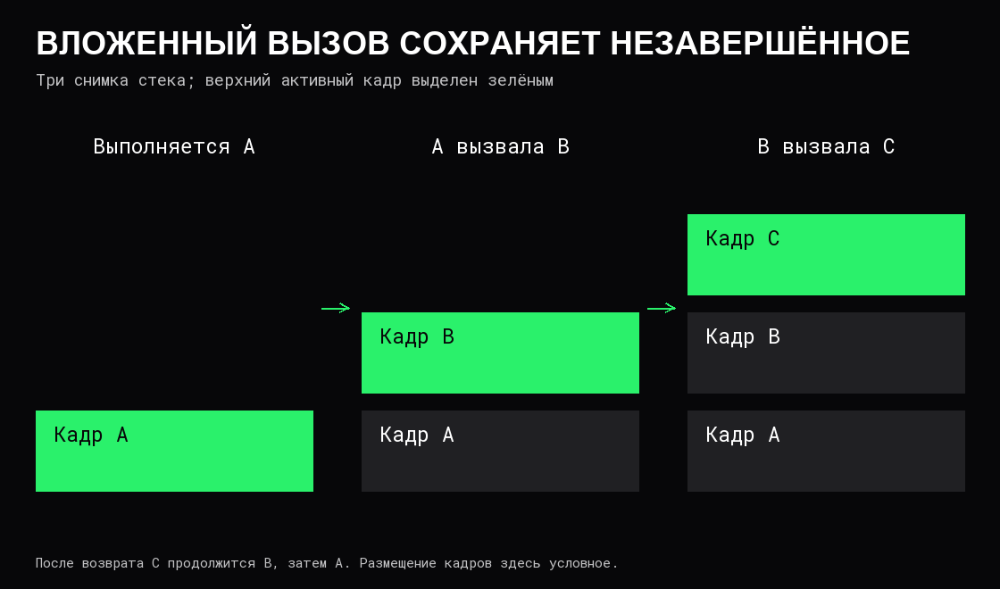

# Вызовы функций и стек

**Функция** описывает вычисление с входными параметрами и результатом. **Вызов** передаёт ей управление и фактические аргументы. Когда функция заканчивает работу обычным возвратом, выполнение продолжается в вызывающем коде.

Функция существует в программе однажды, но её активных вызовов может быть несколько. Каждый вызов должен иметь собственное состояние: параметры, незавершённую работу и место продолжения. Это особенно заметно при рекурсии.

## Как организован вызов

В обычном машинном коде участники соблюдают **соглашение о вызовах**: где передаются аргументы и результат, какие регистры разрешено изменять, кто сохраняет остальные и как выровнена память. Это часть ABI, описанного в [сборке и запуске](01%20Компиляция,%20линковка%20и%20запуск.md).

Типичный вызов включает подготовку аргументов, сохранение места продолжения, переход к функции, выполнение её тела и возврат. Аргументы могут передаваться в регистрах или памяти. Поэтому «каждый аргумент кладётся в стек» — неверная универсальная модель.

## Кадр стека

**Стек вызовов** хранит состояние незавершённых вызовов. **Кадр**, или stack frame, — область состояния конкретного вызова: сохранённые регистры, часть локальных данных и служебная информация. Конкретное размещение определяется инструментами и платформой.



Стек обслуживается по правилу «последний вошёл — первый вышел». Это тот же порядок, что у [стека как структуры данных](09%20Стек,%20очередь%20и%20дек.md), но стек вызовов имеет специальную роль в исполнении программы. У разных [потоков](../Операционные%20системы/02%20Процессы%20и%20потоки.md) обычно отдельные стеки выполнения.

Наличие локального имени в исходнике не гарантирует слот в кадре. Значение может находиться в регистре, жить в динамической памяти или исчезнуть после оптимизации. Встроенная функция может вообще не создавать отдельного кадра.

## Передача значения и доступ к общему объекту

При **передаче по значению** параметр получает значение аргумента. Копируется именно передаваемое значение: если это указатель, копируется указатель, а не весь объект. **Передача по ссылке** в языках, где она предусмотрена, даёт параметру доступ к переменной вызывающей стороны. Это разные механизмы.

Псевдокод показывает два контракта:

```text
увеличить_копию(число):
    число = число + 1

увеличить_объект(указатель):
    значение по указателю = значение по указателю + 1
```

В первом случае изменение параметра не меняет исходную числовую переменную. Во втором копия указателя всё ещё ведёт к общему объекту. Возвращение нового значения — отдельный способ передать результат без изменения общего состояния. Различия копий и алиасов раскрыты в [значениях и указателях](02%20Значения,%20типы%20и%20указатели.md).

## Рекурсия и незавершённая работа

**Рекурсия** — вызов функции самой себя прямо или через другие функции. Нужны условие остановки и движение к нему. Псевдокод суммы положительных целых до `n`: предполагается `n ≥ 0`, а промежуточные суммы помещаются в выбранный числовой тип.

```text
сумма(n):
    если n = 0: вернуть 0
    вернуть n + сумма(n - 1)
```

Для `n = 3` вызов с 3 ждёт результат с 2, тот — с 1, тот — с 0. После возврата 0 последовательно получаются 1, 3 и 6. До возврата самого глубокого вызова остальные должны помнить свои незавершённые сложения.

Здесь выполняется `n + 1` вызовов: время `O(n)`, глубина активных вызовов `O(n)`. При кадрах ограниченного размера стек требует `O(n)` памяти. Без условия остановки или при слишком большой глубине возможно **переполнение стека** — исчерпание доступного места. Способ расширения и пределы зависят от системы.

Итеративный вариант с накопителем может выполнять ту же работу за `O(n)` времени и `O(1)` дополнительной памяти. Замена рекурсии своим стеком не обязательно уменьшает память: состояние незавершённых действий всё равно требуется где-то хранить.

## Оптимизации и время жизни

**Хвостовой вызов** — вызов, после которого функции не нужно продолжать собственное вычисление. Некоторые реализации заменяют его переходом и переиспользуют кадр, но гарантии такой оптимизации зависят от языка и инструментов. Обычный рекурсивный вызов внутри сложения выше не хвостовой.

После возврата область кадра может использоваться снова. Ссылка на данные, жизнь которых действительно закончилась вместе с кадром, становится недопустимой. Другие реализации могут заранее разместить такие данные в более долгоживущем хранилище или запретить опасный возврат. Общая граница — [время жизни данных](04%20Время%20жизни%20и%20владение%20данными.md), а не внешний вид локальной переменной.

Не всякое завершение является обычным возвратом. В системах с исключениями ошибка может передать управление обработчику выше по цепочке вызовов. При **раскрутке стека** покидаются промежуточные кадры и выполняются предусмотренные правила очистки. Аварийное прекращение процесса не обязано выполнять ту же очистку, поэтому автоматическое освобождение нельзя считать гарантией для любого способа остановки.

## Источники

- [Microsoft: пример соглашения о вызовах x64](https://learn.microsoft.com/en-us/cpp/build/x64-calling-convention?view=msvc-170).
- [JVM Specification: кадры как модель активных вызовов](https://docs.oracle.com/javase/specs/jvms/se25/html/jvms-2.html#jvms-2.6).
- [OSTEP: стек и динамическая память](https://pages.cs.wisc.edu/~remzi/OSTEP/vm-api.pdf).
- [Open Data Structures: рекурсивные обходы дерева](https://opendatastructures.org/ods-python/6_1_BinaryTree_Basic_Binary.html).
