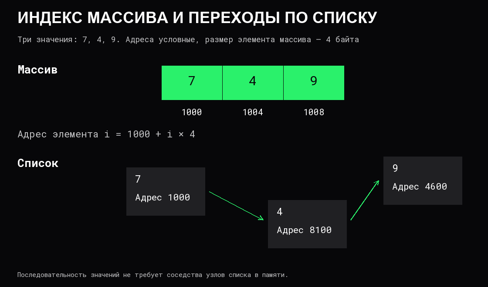

# Массивы и связные списки

Массив и связный список хранят последовательность, но организуют доступ к ней по-разному. Выбор влияет на поиск позиции, изменение порядка, копирование, память и устойчивость ссылок на элементы.

## Массив: доступ по индексу

**Массив** хранит элементы в последовательных позициях памяти. В простой модели элементы имеют одинаковый размер `s`, нумерация начинается с нуля, а адрес элемента `i` вычисляется как `начало + i × s`. При допустимом индексе доступ имеет стоимость `O(1)` в модели ограниченного размера адреса и элемента.

Индекс должен находиться в пределах от 0 до `n - 1`. Вычисленный адрес за пределами выделения не становится допустимым только потому, что арифметика адреса успешна. Проверка границ может выполняться инструментами языка или лежать на вызывающем коде.



Если массив хранит указатели, соседними являются сами указатели, а не обязательно объекты за ними. Преимущества [локальности](../Компьютер/04%20Оперативная%20память%20и%20кэши.md) относятся к фактическому размещению данных.

## Вставка и удаление

В упорядоченной последовательности `[10, 20, 30, 40]` вставка 15 на индекс 1 требует сдвинуть 20, 30 и 40 вправо. При удалении 20 хвост сдвигается влево. В общем случае это `O(n)` перемещений, даже если позиция известна заранее.

Если порядок неважен, удаляемую позицию можно заменить последним элементом и уменьшить длину за `O(1)` перемещений. Это другой контракт: прежний порядок теряется.

В **отсортированном массиве** двоичный поиск сравнивает ключ со средним элементом и оставляет подходящую половину. Получается `O(log n)` сравнений при произвольном доступе за `O(1)`. Быстрый поиск места не отменяет последующего линейного сдвига при вставке. Сравнения длинных ключей имеют собственную цену.

## Динамический массив

Фиксированный массив имеет ограниченное число позиций. **Динамический массив** добавляет описание текущей длины и ёмкости: сколько элементов используется и сколько помещается без смены хранилища.

При свободной ёмкости добавление в конец записывает один элемент. Если места нет, типичная реализация выделяет больший блок, переносит элементы и обновляет описание. Например, рост ёмкости с 4 до 8 при длине 4 требует перенести прежние четыре элемента перед добавлением пятого.

При геометрическом росте ёмкости, например удвоении, добавление имеет [амортизированную стоимость](05%20Сложность%20и%20стоимость%20операций.md) `O(1)`, хотя отдельное расширение требует `O(n)`. Увеличение каждый раз всего на одну позицию может дать `1 + 2 + … + n`, то есть квадратичное число переносов. Конкретный коэффициент роста не универсален.

При удвоении из ёмкости 1 для восьми последовательных добавлений старые элементы копируются только при переходах 1 → 2, 2 → 4 и 4 → 8: всего `1 + 2 + 4 = 7` переносов. Вместе с восемью записями новых элементов это линейная работа. Каждое удвоение учитывает всё более крупный блок, но сумма предыдущих блоков остаётся меньше удвоенного последнего.

Предварительное резервирование уменьшает число расширений, но заранее занимает больше памяти. Расширение может сделать старые указатели на элементы недопустимыми либо оставить их привязанными к прежнему хранилищу — это определяется реализацией. Нельзя предполагать, что все сохранённые представления автоматически переключатся на новый блок.

## Связный список

**Узел односвязного списка** содержит значение и ссылку на следующий узел. Известна голова; при необходимости отдельно хранится хвост. Чтобы добраться до позиции `i`, приходится пройти предшествующие связи: доступ по индексу требует `O(n)` в худшем случае.

Вставка после уже известного узла меняет постоянное число ссылок. Псевдокод вставки нового узла `X` после `A`:

```text
X.next = A.next
A.next = X
```

Если сначала перезаписать `A.next`, не сохранив прежнее продолжение, можно потерять хвост. Для удаления после известного предшественника его ссылку направляют на следующий узел после удаляемого. Удалить произвольный известный узел односвязного списка за `O(1)` в общем случае нельзя без доступа к предшественнику.

**Двусвязный список** хранит ссылки вперёд и назад. При известном узле он позволяет удалить его, обновив соседей, за `O(1)` изменения связей. За это платят дополнительной ссылкой, обслуживанием границ и памятью. Стоимость поиска позиции и выделения нового узла считается отдельно.

## Цена выбора

| Операция | Динамический массив | Связный список |
|---|---|---|
| Доступ по индексу | O(1) | O(n) |
| Поиск значения без порядка | O(n) | O(n) |
| Добавление в конец | O(1) амортизированно | O(1) при сохранённом хвосте |
| Вставка возле известной позиции | O(n) сдвигов | O(1) изменения известных связей |
| Обход | O(n), обычно хорошая локальность | O(n), последовательные переходы по ссылкам |

Список не становится быстрее массива лишь из-за отсутствия копирования: нужны узлы, указатели и обращения к памяти. Массив не подходит ко всем задачам лишь из-за быстрого индексирования. Важны частота изменений, способ поиска позиции, размер элементов и требования к стабильности адресов.

## Общие данные и удержание памяти

Представление участка массива может разделять данные с исходным массивом. Изменение через один путь видно через другой; небольшое представление способно удерживать большой блок. [Владение и время жизни](04%20Время%20жизни%20и%20владение%20данными.md) определяют, допустимы ли изменение на месте, очистка хвоста и переиспользование.

У списка удаление узла из цепочки не всегда освобождает его: на него могут ссылаться другие структуры. Ошибочное изменение ссылки также может создать цикл. Поэтому обход до отсутствующего следующего узла требует, чтобы структура действительно оставалась списком без цикла.

## Источники

- [Open Data Structures: структуры на массивах](https://opendatastructures.org/ods-python/2_Array_Based_Lists.html).
- [Расширение динамического массива](https://opendatastructures.org/ods-python/2_1_ArrayStack_Fast_Stack_O.html).
- [Односвязный список](https://opendatastructures.org/ods-python/3_1_SLList_Singly_Linked_Li.html).
- [Двусвязный список](https://opendatastructures.org/ods-python/3_2_DLList_Doubly_Linked_Li.html).
