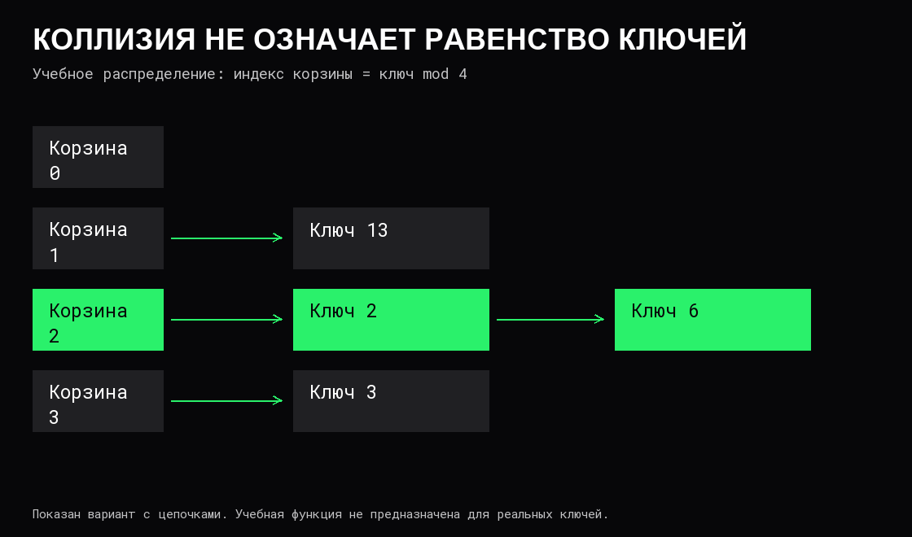

# Хеш-таблицы

**Словарь** хранит соответствие «ключ → значение», **множество** — наличие ключей. **Хеш-таблица** — способ реализации таких интерфейсов с быстрым поиском по точному ключу при подходящих условиях. Сам интерфейс словаря не требует хеш-таблицы: его можно реализовать и через [дерево](08%20Деревья.md).

## От ключа к кандидатам

**Хеш-функция** вычисляет по ключу числовой код. По нему выбирается корзина или начальная позиция в таблице. Например, учебная функция `ключ mod 4` для неотрицательных целых использует остаток деления на четыре. Она намеренно проста и не является рекомендацией для реальной таблицы.

**Коллизия** означает, что разные ключи дали одинаковый хеш или попали в одну позицию после сведения хеша к размеру таблицы. Это нормальная возможность, а не доказательство ошибки. Совпадения хеша недостаточно для равенства ключей: поиск должен проверить сам ключ.

Для поиска 10 в примере выбирается корзина 2. Сравнение с ключами 2 и 6 не находит совпадения — ключ отсутствует. Вернуть значение 2 только из-за совпавшей корзины было бы ошибкой.

## Как разрешаются коллизии

**Цепочки:** каждая корзина содержит набор записей, например список. Поиск выбирает корзину и проверяет её записи. Добавление нового ключа не должно случайно заменить другой ключ той же корзины.

**Открытая адресация:** записи находятся в общем массиве. Если начальная позиция занята, алгоритм проверяет другие позиции по заданной последовательности. При линейном пробировании это соседние ячейки с переходом к началу массива.

Удаление в открытой адресации требует сохранить возможность найти записи дальше по последовательности. Если просто превратить занятую позицию в обычную пустую, поиск может остановиться раньше нужного ключа. Используют отметки удаления, перенос части записей или перестройку — в зависимости от алгоритма.

## Заполнение и рост

**Коэффициент заполнения** `α = n / m` связывает число записей `n` с числом корзин или слотов `m`. Его допустимые пределы зависят от способа хранения. Для цепочек `α` может быть больше единицы; для открытой адресации нужны доступные позиции и ограничение заполнения.

При росте таблицы меняется размещение записей. **Рехеширование** распределяет их в новое хранилище; старые индексы корзин нельзя просто сохранить, если выбор зависит от размера. Реализация может переносить всё сразу или постепенно.

Один такой рост требует работы по множеству записей и дополнительной памяти. Поэтому дешёвые обычные вставки не означают одинаковую задержку каждой вставки. Уменьшение и очистка отметок удаления тоже могут требовать перестройки.

## Какие гарантии даёт O(1)

При хорошем распределении ключей, ограниченном заполнении и ключах фиксированной стоимости обычный поиск имеет ожидаемую стоимость `O(1)`. Вставка с учётом периодического роста обычно описывается ожидаемой амортизированной оценкой. Это разные условия, разобранные в [сложности](05%20Сложность%20и%20стоимость%20операций.md).

Если все ключи попали в одну цепочку, поиск требует до `O(n)` сравнений. В открытой адресации неудачное распределение также может создавать длинные группы занятых позиций. Некоторые реализации применяют дополнительные защиты; их гарантии нельзя приписывать любой хеш-таблице.

Вычисление хеша строки длины `k` с нуля обычно требует `O(k)` чтений. Сравнение ключей также может зависеть от их длины. Следовательно, «поиск за O(1)» относительно числа записей не превращает обработку произвольного ключа в бесплатную операцию.

## Контракт ключа

Равные по принятому сравнению ключи должны давать одинаковый хеш. Обратное не требуется. Если ключом является запись, хеширование и сравнение должны учитывать согласованный набор полей.

Изменение поля ключа после помещения в таблицу может сделать запись недоступной по новому поиску: она осталась в корзине прежнего хеша. Поэтому ключи обычно сохраняют неизменяемыми либо удаляют и вставляют заново по правилам реализации.

Равенство объектов по содержимому и [идентичность](02%20Значения,%20типы%20и%20указатели.md) — разные контракты. Строковая нормализация, регистр букв и сравнение специальных числовых значений также требуют явного решения, если допускаются в ключах.

## Подходящие и неподходящие операции

Хеш-таблица удобна для поиска пользователя по идентификатору, подсчёта частот и удаления дублей. Она сама по себе не обеспечивает отсортированный обход, поиск ближайшего ключа или все ключи в диапазоне. Для этого могут понадобиться дерево, отсортированный массив или дополнительный индекс.

Отсутствие ключа нужно отличать от наличия со значением 0 или пустой строкой: интерфейс должен возвращать отдельный признак либо другой однозначный результат. Порядок обхода, устойчивость ссылок после роста и возможность конкурентного доступа определяет конкретная реализация.

Таблица может [удерживать память](04%20Время%20жизни%20и%20владение%20данными.md) через ключи и значения; удаление всех записей не обязано уменьшить её ёмкость. Безопасность совместного чтения и изменения требует отдельного [протокола синхронизации](../Операционные%20системы/04%20Конкурентность%20и%20синхронизация.md).

## Источники

- [Open Data Structures: словарь как интерфейс и его реализации](https://opendatastructures.org/ods-python/1_2_Interfaces.html).
- [Хеширование с цепочками](https://opendatastructures.org/ods-python/5_1_ChainedHashTable_Hashin.html).
- [Открытая адресация и линейное пробирование](https://opendatastructures.org/ods-python/5_2_LinearHashTable_Linear_.html).
- [Вычисление хеш-кодов](https://opendatastructures.org/ods-python/5_3_Hash_Codes.html).
