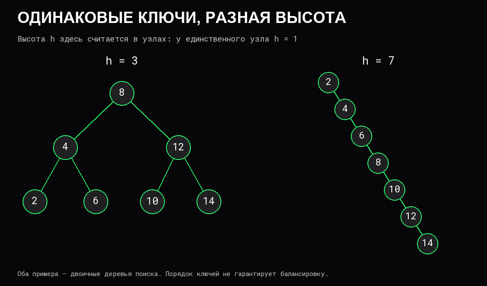

# Деревья

**Дерево** — связная структура узлов и связей без циклов. В корневом дереве выбран **корень**; у остальных узлов есть один родитель и могут быть дети. Узел без детей называется **листом**. **Поддерево** состоит из узла и всех его потомков.

Дерево описывает иерархию, но само по себе не задаёт порядок ключей или скорость поиска. Дерево каталогов, двоичное дерево поиска и двоичная куча решают разные задачи.

## Высота и форма

**Глубина узла** — число рёбер от корня; глубина корня равна 0. В этой статье **высота дерева h** измеряется числом узлов на самом длинном пути от корня до листа: у одного узла `h = 1`, у пустого дерева `h = 0`. При другой договорённости высоту считают в рёбрах, поэтому единицы нужно уточнять.

**Двоичное дерево** имеет не более двух детей у каждого узла. Оно может иметь высоту порядка `log n`, но может превратиться и в цепочку высоты `n`.

Число узлов само по себе не определяет цену пути. Если операция спускается от корня, её стоимость часто составляет `O(h)`.

## Двоичное дерево поиска

Для **BST**, двоичного дерева поиска, задаётся порядок: все ключи левого поддерева меньше ключа узла, правого — больше. Для повторяющихся ключей нужен отдельный контракт: запрет, счётчик или иной согласованный способ хранения.

При поиске ключ сравнивается с текущим узлом. Если меньше — поиск продолжается слева, больше — справа. Если равен — найден; если подходящего ребёнка нет — ключ отсутствует.

Проверять порядок только у соседних узлов недостаточно. Если слева от корня 10 стоит узел 5, а справа от 5 — узел 12, локальное сравнение 5 < 12 выполнено. Но 12 нарушает ограничение всего левого поддерева корня. Каждому потомку нужны границы, накопленные от всех предков.

Вставка находит подходящее пустое место по тому же спуску. Удаление листа просто убирает связь; узел с одним ребёнком заменяется этим ребёнком. Для узла с двумя детьми можно использовать следующий по порядку ключ — минимум правого поддерева — и удалить его на прежнем месте, сохранив порядок.

## Зачем нужна балансировка

Последовательная вставка возрастающих ключей в обычное BST без балансировки может создать цепочку. Поиск, вставка и удаление тогда требуют `O(n)` времени в худшем случае.

**Сбалансированные деревья** поддерживают ограничения формы при изменениях. Например, AVL-деревья ограничивают разницу высот поддеревьев, красно-чёрные — соотношения цветов и чёрных узлов на путях. Эти правила дают логарифмическую высоту; обновления используют локальные перестройки, в том числе **повороты**, сохраняющие порядок ключей.

Поиск и изменение в таких деревьях имеют худшую оценку `O(log n)` при постоянной стоимости сравнения. Различия конкретных алгоритмов важны для реализации, но из одного слова «дерево» такая гарантия не следует.

Дерево поиска сохраняет порядок: обход слева → узел → справа выдаёт отсортированную последовательность. Можно искать минимальный ключ не меньше заданного и выдавать диапазон. Для сбалансированного дерева поиск начала и последовательная выдача `k` результатов укладываются в `O(log n + k)` при подходящем обходе и постоянной стоимости сравнения.

## Обход в глубину и по уровням

**DFS**, обход в глубину, завершает выбранную ветку прежде соседней. Порядок обработки узла может быть до детей, между ними или после них. **BFS**, обход в ширину, обрабатывает узлы по уровням, используя очередь.

При однократной обработке каждого узла оба обхода требуют `O(n)` времени. Рекурсивный DFS хранит `O(h)` активных вызовов. BFS хранит до `O(w)` элементов, где `w` — максимальная ширина уровня; это может быть `O(n)`. [Стек и очередь](09%20Стек,%20очередь%20и%20дек.md) определяют порядок незавершённой работы.

Повторный расчёт высоты каждого поддерева с нуля способен дать `O(n²)` на цепочке. Один обход после детей может вернуть сразу высоту и результат проверки, не повторяя ту же работу. [Цена рекурсии](03%20Вызовы%20функций%20и%20стек.md) зависит от формы дерева.

## Двоичная куча и очередь приоритетов

**Двоичная min-куча** поддерживает другое условие: ключ родителя не больше ключей его детей. Минимум находится в корне, но левое поддерево не обязано быть меньше правого. Поэтому поиск произвольного ключа может требовать `O(n)`.

Форма кучи заполняет уровни слева направо. Её удобно хранить в [массиве](06%20Массивы%20и%20связные%20списки.md): у элемента `i` дети находятся по индексам `2i + 1` и `2i + 2`, если эти индексы существуют. Добавление поднимает новый элемент к родителю; извлечение минимума заменяет корень последним и опускает его. Восстановление порядка требует `O(log n)` сравнений, просмотр минимума — `O(1)`.

Если массив кучи расширяется, отдельно учитываются переносы хранилища. Построить кучу снизу из готового массива можно за `O(n)`; последовательные вставки имеют другую оценку.

Куча подходит для выбора ближайшего срока или наиболее приоритетной задачи. Это **очередь приоритетов**, а не FIFO. Куча как структура также не совпадает с кучей [динамической памяти](04%20Время%20жизни%20и%20владение%20данными.md).

## Источники

- [Open Data Structures: основные понятия дерева](https://opendatastructures.org/ods-python/6_Binary_Trees.html).
- [Двоичное дерево поиска](https://opendatastructures.org/ods-python/6_2_BinarySearchTree_Unbala.html).
- [Красно-чёрные деревья и гарантии высоты](https://opendatastructures.org/ods-python/9_Red_Black_Trees.html).
- [Двоичная куча](https://opendatastructures.org/ods-python/10_1_BinaryHeap_Implicit_Bi.html).
