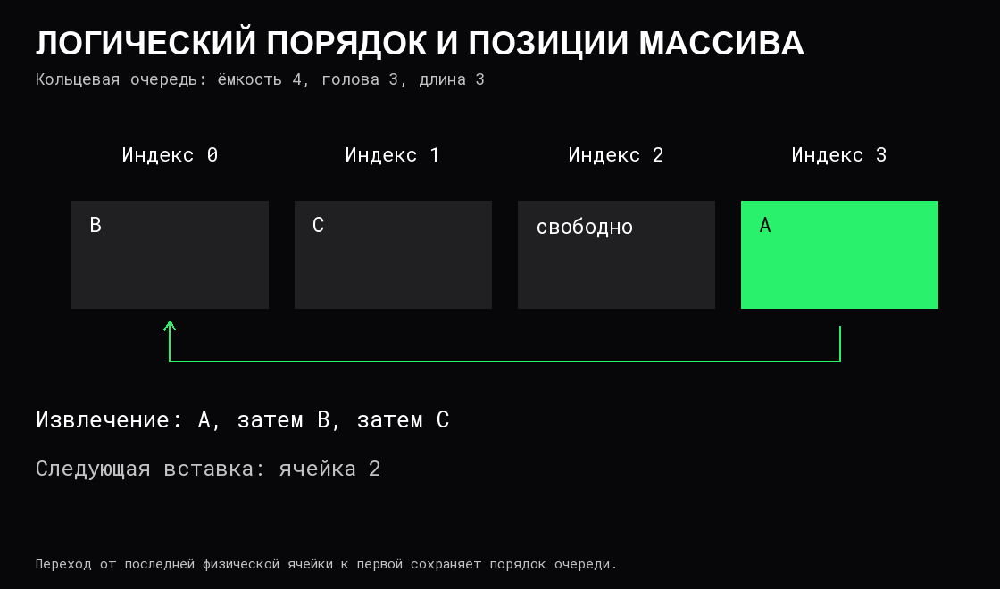

# Стек, очередь и дек

Стек, очередь и дек определяют, откуда добавляются и извлекаются элементы. Это **абстрактные типы данных** — контракты операций. Они не требуют одного конкретного размещения в памяти: реализацией может быть массив или связные узлы.

## Стек: последний вошёл — первый вышел

**Стек**, LIFO, добавляет и извлекает элементы с одного конца, вершины. `push` добавляет, `pop` извлекает, `peek` читает вершину без удаления. После добавления A, B, C порядок извлечения будет C, B, A.

Стек хранит незавершённую работу. Например, при разборе вложенных скобок очередная закрывающая должна соответствовать последней открытой. Для `([)]` числа открытий и закрытий совпадают, но вложенность нарушена: перед `)` на вершине находится `[`.

Псевдокод проверки одного типа скобок:

```text
для каждого символа:
    если это открывающая скобка: добавить её в стек
    если это закрывающая скобка:
        если стек пуст: вернуть «неверно»
        иначе снять верхнюю открывающую
после прохода вернуть результат проверки «стек пуст»
```

Для нескольких типов при снятии дополнительно сравниваются типы. Каждый символ обрабатывается один раз: время `O(n)`, память до `O(n)`. [Стек вызовов](03%20Вызовы%20функций%20и%20стек.md) использует тот же порядок завершения, но служит выполнению функций.

## Очередь: первый вошёл — первый вышел

**Очередь**, FIFO, добавляет в хвост и извлекает из головы. После добавления A, B, C извлечение выдаёт A, B, C. Это удобно для обхода [дерева по уровням](08%20Деревья.md) и передачи работы в порядке поступления.

Порядок извлечения не равен порядку завершения: два исполнителя могут взять A и B последовательно, но закончить B раньше A. FIFO сама по себе не гарантирует справедливое распределение CPU, сохранность задач при сбое или отсутствие повторной обработки.

Пустая структура требует отдельного результата: ошибка, признак отсутствия или другой оговорённый контракт. Нулевое значение элемента может быть полноценными данными и не обязано означать пустоту.

## Кольцевой буфер

Если очередь реализована простым массивом и при каждом извлечении сдвигает хвост, операция стоит `O(n)`. **Кольцевой буфер** хранит индекс головы и число элементов, а индексы вычисляет по модулю ёмкости.

Для логической позиции `j` физический индекс равен `(голова + j) mod ёмкость`, где `0 ≤ j < длина`. Следующее место вставки — `(голова + длина) mod ёмкость`, если буфер ещё не полон. Положение в массиве не равно возрасту элемента.



При фиксированной ёмкости добавление и извлечение требуют `O(1)` работы над индексами и одним элементом. При росте нужно получить новый массив и сохранить логический порядок: редкое расширение требует `O(n)`. Голова и хвост без дополнительных условий могут совпадать и у пустого, и у полного буфера; число элементов либо другая явная схема различает эти состояния.

## Двусторонняя очередь

**Дек**, deque, позволяет добавлять и удалять с обоих концов. Он может использовать кольцевой массив или двусвязный список. Обычный стек и FIFO можно получить, выбрав подходящие операции дека, но контракт доступных операций у них уже.

Дек полезен, когда данные добавляются с одного края, а устаревшие удаляются с другого. Его конкретные гарантии — доступ по индексу, сохранность ссылок, рост — зависят от реализации, а не только от названия.

## Цена реализации

| Реализация | Что обеспечивает | Что учитывать |
|---|---|---|
| Стек на динамическом массиве | Добавление в конец O(1) амортизированно, снятие O(1) без сжатия | Рост иногда переносит все элементы |
| Очередь на кольцевом массиве | Концы O(1) без изменения ёмкости | При росте сохраняется логический порядок |
| Односвязный список с головой и хвостом | Вставка в хвост и снятие головы O(1) изменения связей | Выделение и освобождение узлов — отдельные затраты |
| Двусвязный список | Работа с обоими концами O(1) изменения связей | Дополнительные ссылки и менее плотное размещение |

Подробности размещения и изменения связей описаны в [массивах и списках](06%20Массивы%20и%20связные%20списки.md), различие отдельных и амортизированных затрат — в [сложности](05%20Сложность%20и%20стоимость%20операций.md).

## Ёмкость, память и конкурентность

Неограниченная очередь может накапливать данные быстрее обработки. Ограниченная должна явно определить поведение при заполнении: ожидать, отказать, вытеснить старые данные или применить другую политику. У каждого варианта разные последствия для задержки и потери работы. [Обратное давление](../Операционные%20системы/05%20Файлы%20и%20системные%20вызовы.md) связывает предел очереди со скоростью приёма.

После извлечения ссылка в неиспользуемой ячейке массива может продолжать удерживать объект. При полном владении хранилищем её убирают по правилам реализации; сама логическая длина не обязательно освобождает [связанные данные](04%20Время%20жизни%20и%20владение%20данными.md).

Обычная очередь не становится безопасной для нескольких исполнителей автоматически. Проверка «не пусто», извлечение, публикация элемента и изменение индексов должны соблюдать единый [протокол синхронизации](../Операционные%20системы/04%20Конкурентность%20и%20синхронизация.md). Отмена ожидания и завершение работы — дополнительные условия конкурентного интерфейса.

## Источники

- [Open Data Structures: интерфейсы стека, очереди и дека](https://opendatastructures.org/ods-python/1_2_Interfaces.html).
- [Стек на массиве](https://opendatastructures.org/ods-python/2_1_ArrayStack_Fast_Stack_O.html).
- [Кольцевая очередь](https://opendatastructures.org/ods-python/2_3_ArrayQueue_Array_Based_.html).
- [Дек на массиве](https://opendatastructures.org/ods-python/2_4_ArrayDeque_Fast_Deque_O.html).
